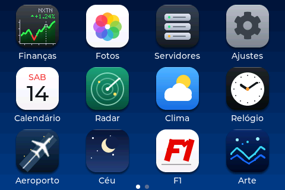
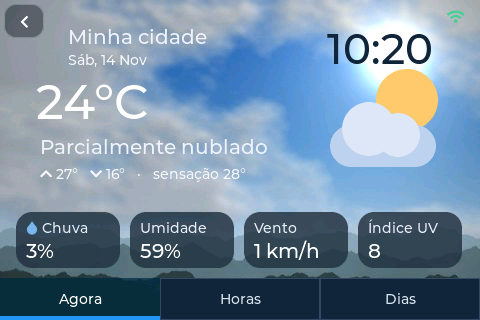
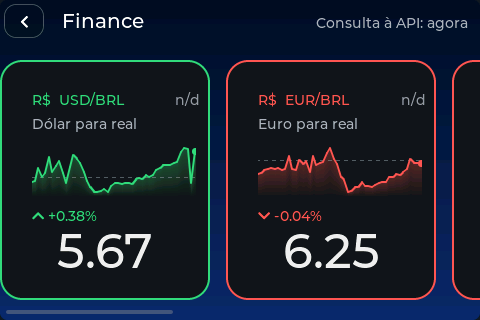
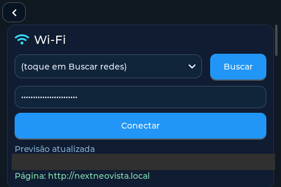
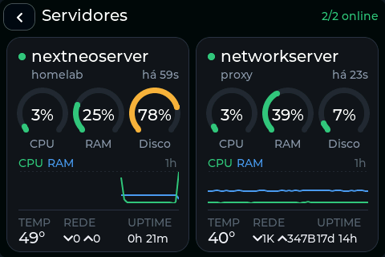
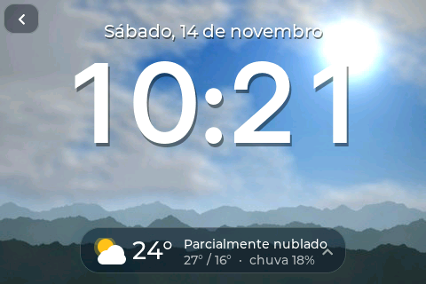
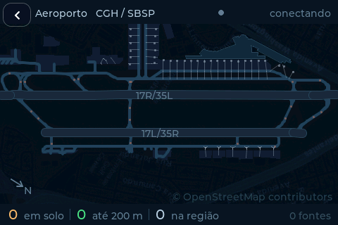
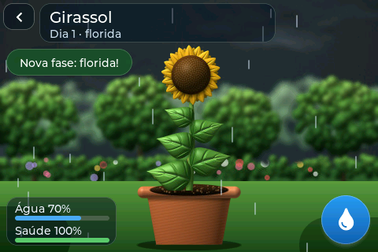

# NextNeo Vista

Firmware do **NextNeo Vista**, um painel de informações com tela touch (clima, finanças, radar de aviões, aeroporto, F1, futebol, céu, relógio, fotos, jardim e mais), para placas ESP32. O nome identifica o projeto e não aparece na interface do aparelho.

| Placa | Pasta | Estado |
|---|---|---|
| **Guition JC3248W535C**: ESP32-S3, tela 3,5" 480×320 | [`esp32-s3/`](esp32-s3/) | completa (14 telas), em **modo manutenção** |
| **Waveshare ESP32-P4-WIFI6-Touch-LCD-5**: ESP32-P4, tela 5" 720×1280 | [`esp32-p4/`](esp32-p4/) | **esqueleto** pronto para a chegada da placa (seção 11) |

O código comum às placas (APIs, dados, página web, infraestrutura) fica em [`shared/`](shared/). Build e gravação rodam no Docker, sem instalar nada (seção 1.1).

> Especificação completa do produto: [`docs/index.html`](docs/index.html). É uma página única com hardware, mapa de pinos, catálogo de firmwares e arquitetura do hub.

---

## Sumário

0. [Primeiros passos](#0-primeiros-passos)
1. [Compilar e gravar (início rápido)](#1-compilar-e-gravar-início-rápido)
   - [Build e gravação via Docker (padrão, sem instalar nada)](#11-build-e-gravação-via-docker-padrão-sem-instalar-nada)
2. [Comandos úteis](#2-comandos-úteis)
3. [Por que não usar `-t upload`](#3-por-que-não-usar--t-upload-nesta-placa)
4. [Solução de problemas](#4-solução-de-problemas)
5. [Telas do app](#5-telas-do-app)
6. [Memória: PSRAM x RAM interna (TLS)](#6-memória-psram-x-ram-interna-tls)
7. [Estrutura do código e arquitetura](#7-estrutura-do-código-e-arquitetura)
8. [Hardware](#8-hardware)
9. [Exemplos e hub de jogos](#9-exemplos-e-hub-de-jogos)
10. [Testes automáticos](#10-testes-automáticos)
11. [Placas: S3, P4 e como criar uma nova](#11-placas-s3-p4-e-como-criar-uma-nova)

---

## 0. Primeiros passos

Para quem nunca mexeu com C++ nem com placas. Se você já conhece o mundo embarcado, pule para a seção 1.

### 0.1 O que é este projeto, em uma frase

É **um único programa** (o *firmware*) que roda sozinho na placa, sem sistema operacional como Linux ou Windows por baixo. Ligou a placa, o programa começa; ele desenha a tela, lê o toque, conecta no Wi-Fi e chama APIs na internet. Não existe "instalar outro app" na placa: para mudar qualquer coisa, você edita o código, compila e grava o programa novo por cima.

### 0.2 Termos do projeto

| Termo | O que é | (em Java) |
|---|---|---|
| **ESP32-S3 / ESP32-P4** | o processador da placa (Wi-Fi, PSRAM, vários núcleos) | |
| **Firmware** | o programa gravado na placa: `nextneo-vista.bin` | o `.jar` |
| **PlatformIO** (`pio`) e **`platformio.ini`** | baixa dependências (`lib_deps`), compila e grava; cada pasta de placa tem o seu `platformio.ini` | Maven + `pom.xml` |
| **Gravar / flash** | copiar o `.bin` para a placa pelo cabo USB | deploy |
| **Monitor serial** | onde aparecem os `Log.printf(...)`; também em `http://IP-DA-PLACA/log` | console |
| **`.h` e `.cpp`** | o `.h` declara, o `.cpp` implementa; `#include "x.h"` traz as declarações | interface / classe |
| **`setup()` e `loop()`** | chamados pelo Arduino: uma vez ao ligar e depois em laço, para sempre | `main()` |
| **LVGL** | biblioteca de interface (botões, labels, abas): funções `lv_...` | |
| **Task do FreeRTOS** | uma thread; a rede roda numa task separada para não travar a tela | `Thread` |
| **`xSemaphoreTake/Give(mtx)`** | trava os dados compartilhados entre a task de rede e a de tela | `synchronized` |
| **`Preferences`** (NVS) | guarda Wi-Fi, cidade, ativos etc.; sobrevive a reinício | |
| **PSRAM x RAM interna** | memória grande e lenta x pequena e rápida (seção 6) | |
| **Unity** e **`pio test`** | biblioteca de testes e o comando que os roda (seção 10) | JUnit |

Três cuidados que mudam o jeito de programar:

1. **Não há garbage collector.** O que é alocado com `new`/`malloc` precisa ser liberado. Por isso o código reaproveita objetos e evita criar `String` à toa.
2. **Memória é pouca.** Um handshake HTTPS consome ~50 KB de RAM interna. Faltou memória, a chamada simplesmente falha, sem exceção (seção 6).
3. **Só a thread da tela mexe na tela.** A task de rede só grava dados (em `sh` ou nos dados do módulo, como `wx` do Clima) e a tela redesenha depois.

### 0.3 Instalar as ferramentas (uma vez só)

> **Caminho padrão: só o Docker.** Com o [Docker Desktop](https://www.docker.com/products/docker-desktop/) (macOS) ou o Docker Engine (Linux) instalado e aberto, `./tools/firmware.sh` compila e grava a placa sem PlatformIO, Python ou toolchain no computador (seção 1.1). Os passos abaixo são a **segunda opção** (`--local`), para quem prefere o PlatformIO instalado.

1. Instale o **VS Code** e, dentro dele, a extensão **PlatformIO IDE** (menu Extensions, busque "PlatformIO"). Ela instala o `pio` e o Python que ele usa.
   - Alternativa só com terminal: instale o [PlatformIO Core](https://platformio.org/install/cli).
2. Conecte a placa ao computador com um cabo USB-C **de dados** (alguns cabos só carregam).
3. Confira se o computador enxerga a placa:

   | Sistema | Comando | Aparece algo como |
   |---|---|---|
   | macOS | `ls /dev/cu.usbmodem*` | `/dev/cu.usbmodem1201` |
   | Linux | `ls /dev/ttyACM*` | `/dev/ttyACM0` |

   Não precisa instalar driver: a placa usa o USB nativo do ESP32-S3. Os scripts do projeto acham a porta sozinhos nos dois sistemas.

#### Só no Linux (uma vez)

```sh
sudo apt install python3-pip pipx build-essential git        # Debian/Ubuntu (Fedora: dnf install ...)
pipx install platformio                                       # ou: pip install --user platformio
sudo usermod -aG dialout $USER                                # permissão na porta serial (Arch: grupo uucp)
curl -fsSL https://raw.githubusercontent.com/platformio/platformio-core/develop/platformio/assets/system/99-platformio-udev.rules | sudo tee /etc/udev/rules.d/99-platformio-udev.rules
sudo udevadm control --reload-rules && sudo udevadm trigger
```

Depois **saia e entre de novo** na sessão, para o grupo `dialout` valer. O `build-essential` traz o compilador `g++`, usado pelos testes que rodam no computador (seção 10.7). No macOS esse compilador vem com as *Command Line Tools* (`xcode-select --install`).

### 0.4 O ciclo de trabalho do dia a dia

```text
editar código (.cpp/.h)  →  testar na placa  →  gravar o app  →  olhar o log
```

Na prática é um comando só, na pasta do repositório:

```sh
./tools/firmware.sh s3 deploy      # placa S3; p4 para a placa nova
```

> **Regra do projeto: deploy é sempre com teste.** O script roda os testes automáticos na placa e só grava o app se todos passarem (seção 1). `upload` grava sem testar; use só quando souber o que está fazendo.

### 0.5 Onde fica o código de verdade

- **`shared/src/`**: o que vale para todas as placas (dados das telas, APIs, página web, gerenciador de telas, tarefa de rede, boot).
- **`esp32-s3/src/`** e **`esp32-p4/src/`**: o que é de cada placa (telas, driver de tela e touch, kit de UI).
- `esp32-s3/examples/` (jogos e demos) não entra no build do app.

A seção 7 explica como as peças se encaixam.

### 0.6 Primeira configuração do aparelho

1. Ligue a placa e abra **Ajustes** (ícone de engrenagem).
2. Em **Wi-Fi**, toque em buscar, escolha a rede, digite a senha e conecte.
3. Anote o endereço IP que aparece em Ajustes (ex.: `192.168.66.183`).
4. No celular ou computador, na mesma rede, abra `http://192.168.66.183`. É a **página web de configuração** (seção 5).
5. Em **Clima e relógio**, configure o local (veja a seguir).

### 0.7 Configurar o local do clima

O campo **Cidade** aceita dois formatos, tanto na página web quanto em Ajustes na placa:

| Formato | Exemplo | O que acontece |
|---|---|---|
| Nome da cidade | `São Paulo, BR` | A placa procura a cidade e usa o ponto "central" que o serviço adota. O `, BR` limita a busca ao Brasil. |
| Nome + coordenadas | `Minha casa @ -xx.xxx,-xx.xxx` | Usa exatamente esse ponto. O texto antes do `@` é só o nome mostrado na tela. |

**Como pegar as coordenadas:** no Google Maps, clique com o botão direito no local e clique nos números que aparecem (ex.: `-xx.xxx, -xx.xxx`). Eles são copiados. Cole depois do `@`.

Dicas:

- Use coordenadas se quiser a temperatura do seu bairro. "São Paulo, BR" cai na Zona Norte (≈ -23.51, -46.61).
- Primeiro vem a latitude (negativa no hemisfério sul), depois a longitude (negativa no Brasil).
- O nome/local só é usado pelo Clima e pelo Relógio. O fuso horário vem junto com a resposta do clima. O Radar usa o aeroporto configurado à parte.
- A temperatura vem do **Open-Meteo**, que é um modelo de previsão, não um termômetro. Pode ficar 1–3 °C diferente do Google/Climatempo, que usam estações de medição.

---

## 1. Compilar e gravar (início rápido)

**Pré-requisitos:** Docker (seção 1.1, padrão) **ou** macOS/Linux com [PlatformIO Core](https://platformio.org/install/cli) (`pio`) e a placa conectada por USB (seção 0.3). A placa aparece como `/dev/cu.usbmodem*` no macOS e `/dev/ttyACM*` no Linux; não precisa de driver.

Abra o Terminal na pasta do projeto:

```sh
cd caminho/para/nextneo-vista     # a pasta onde você clonou o repositório
```

### 1.1 Build e gravação via Docker (padrão, sem instalar nada)

Único requisito: **Docker** rodando (Docker Desktop no macOS; Docker Engine no Linux). Todo o resto (Python, PlatformIO, toolchain do ESP32, `esptool`) fica dentro da imagem [`docker/Dockerfile`](docker/Dockerfile).

```sh
./tools/firmware.sh build      # compila o app (env nextneo-vista)
./tools/firmware.sh deploy     # testes + gravação, o mesmo da Opção A abaixo (padrão do projeto)
./tools/firmware.sh upload     # compila e grava na placa SEM testes (porta detectada sozinha)
./tools/firmware.sh monitor    # monitor serial, 115200 (Ctrl+C sai)
./tools/firmware.sh clean      # limpa o build
./tools/firmware.sh image      # (re)constrói só a imagem Docker
./tools/firmware.sh cleanup    # apaga imagem, volume, cache de build e .pio-docker (upload/deploy já fazem isso no fim)
./tools/firmware.sh pio test -e native        # qualquer comando do pio, dentro do Docker
./tools/firmware.sh esptool --port /dev/cu.usbmodem1201 chip-id   # esptool, dentro do Docker
```

**Placa:** o primeiro argumento escolhe a pasta: `s3` (padrão, `esp32-s3/`), `p4` (`esp32-p4/`, quando existir) ou `shared` (testes de lógica). Ex.: `./tools/firmware.sh s3 deploy`, `./tools/firmware.sh shared pio test -e native`. Sem a placa, vale `s3`.

Opções: `-e <env>` (outro ambiente do `platformio.ini`, ex. `-e snake`), `-p <porta>` (ex. `-p /dev/cu.usbmodem1201`).

**Segunda opção, sem Docker:** acrescente `--local` (ou `USE_DOCKER=0`) e o script usa o `pio` instalado no computador (seção 0.3):

```sh
./tools/firmware.sh --local upload
```

Como funciona:

| Item | Detalhe |
|---|---|
| Imagem | `nextneo-vista-pio:<hash do Dockerfile>`. Construída sozinha no primeiro uso e reconstruída quando o `Dockerfile` muda. PlatformIO Core 6.2.0 (exigido pela plataforma pioarduino). |
| Cache | Toolchain, framework e bibliotecas ficam no volume Docker `nnv-platformio`: baixados só na primeira vez (~2–3 GB). Apagar: `docker volume rm nnv-platformio`. |
| Saída do build | `<placa>/.pio-docker/build/<env>/` (no Docker) e `<placa>/.pio/build/<env>/` (no `--local`), ex. `esp32-s3/.pio-docker/build/nextneo-vista/`. São pastas separadas para os dois builds não se misturarem; `.pio-docker/` está no `.gitignore`. |
| Gravação no Linux | A porta (`/dev/ttyACM0`) é repassada ao container com `--device`. |
| Gravação no macOS | O Docker no Mac não acessa USB. O script sobe [`tools/serial_bridge.pl`](tools/serial_bridge.pl), uma ponte **RFC 2217** (serial por TCP) escrita em Perl, que já vem no macOS. Ela escuta só em `127.0.0.1`, numa porta livre, repassa dados e os sinais DTR/RTS (que o `esptool` usa para entrar no modo de gravação) e é encerrada no fim do comando. O container grava por `rfc2217://host.docker.internal:<porta>`. |
| Reset de gravação | `platformio.ini` fixa `board_upload.before_reset = usb-reset` (seção `[esp32]`). Pela ponte RFC 2217 o `esptool` não consegue ler o VID/PID da placa e usaria o reset de placas com chip USB-UART, que falha com *"Wrong boot mode detected (0x28)"*. O aviso *"Failed to get VID/PID ... Using standard reset sequence"* no log é esperado e inofensivo. |
| Monitor | `./tools/firmware.sh monitor` precisa de um terminal interativo (não funciona com saída redirecionada). |
| Arquivos criados | O container roda com o seu usuário (`--user`), então os arquivos do build são seus, não do root. |

> `upload` usa `pio run -t upload`: grava bootloader, tabela de partições (a mesma `default_8MB.csv`, seção 3) e o app, **sem rodar os testes**. Para o fluxo com testes, use a Opção A abaixo.
> Precisa de espaço livre: a imagem + o volume ocupam alguns GB no disco do Docker. Com o disco do Mac cheio o Docker Desktop pode travar (*"no space left on device"*); libere espaço e reinicie o Docker Desktop.
>
> **Verificado em 2026-11-16 (macOS, Apple Silicon, Docker Desktop 4.82):** `build` (~5 min na primeira vez, baixando o toolchain) e `upload` para `/dev/cu.usbmodem1201` com *Hash of data verified* em todos os blocos.
>
> O deploy com testes (Opção A) também roda no Docker por padrão: chama `tools/firmware.sh pio` e `tools/firmware.sh esptool`, e o build vai para `esp32-s3/.pio-docker/`; `BOARD=p4` escolhe a outra placa. Verificado com `QUICK=1`: 53 testes no computador, `test_smoke` na placa (a leitura dos resultados também passa pela ponte serial), compilação e gravação verificada. Só o `tools/flash_hub.sh` (hub de jogos, seção 9) ainda exige o PlatformIO instalado.

### Opção A: deploy com testes (padrão)

```sh
chmod +x tools/deploy_nextneo_vista.sh     # só na primeira vez
./tools/deploy_nextneo_vista.sh            # ou: ./tools/firmware.sh deploy
```

Roda **no Docker por padrão** (seção 1.1): não precisa de PlatformIO instalado. Para usar o PlatformIO do computador: `USE_DOCKER=0 ./tools/deploy_nextneo_vista.sh` (ou `./tools/firmware.sh --local deploy`).

O script faz quatro coisas, nesta ordem, e **para no primeiro erro**:

0. **Testa a lógica no computador** (`pio test -e native`, ~10 s, seção 10.7). Se falhar, nada é gravado.
1. **Testa na placa:** roda os testes automáticos na placa (`pio test`, seção 10). Se algum falhar, o app **não** é gravado e a placa fica com o firmware de teste. A saída completa vai para `logs/test.log`.
2. **Compila** o app `nextneo-vista` e confere se ele cabe na partição de 3264 KB.
3. **Grava somente o app** em `0x10000` e confere o `Hash of data verified`. Bootloader, partições e Wi-Fi salvo ficam intactos.

Leva uns 9 minutos (quase tudo nos testes da placa). Para **mudanças simples** (um texto, uma cor, um tempo), use `QUICK=1`: roda os testes do computador e só a suíte `test_smoke` na placa (abre cada tela uma vez), ~4 minutos no total. Variações:

```sh
./tools/deploy_nextneo_vista.sh /dev/cu.usbmodem1201        # informar a porta (macOS)
./tools/deploy_nextneo_vista.sh /dev/ttyACM0                # informar a porta (Linux)
QUICK=1 ./tools/deploy_nextneo_vista.sh                     # mudança simples: teste rápido (~4 min no total)
SUITES="test_screens" ./tools/deploy_nextneo_vista.sh       # testar só uma suíte
CLEAN=1 ./tools/deploy_nextneo_vista.sh                     # limpar o build antes
MONITOR=1 ./tools/deploy_nextneo_vista.sh                   # abrir o monitor serial no final
SKIP_TESTS=1 ./tools/deploy_nextneo_vista.sh                # EMERGÊNCIA: gravar sem testar
USE_DOCKER=0 ./tools/deploy_nextneo_vista.sh                # sem Docker (PlatformIO instalado)
```

### Opção B: passo a passo

```sh
./tools/firmware.sh s3 clean       # 1) limpar (obrigatório após mudar flags do platformio.ini)
./tools/firmware.sh s3 build       # 2) compilar
ls /dev/cu.usbmodem*               # 3) achar a porta (Linux: ls /dev/ttyACM*)
./tools/firmware.sh s3 esptool --chip esp32s3 --port /dev/cu.usbmodem1201 --baud 921600 \
  --before usb-reset write_flash 0x10000 .pio-docker/build/nextneo-vista/nextneo-vista.bin   # 4) gravar SÓ o app
./tools/firmware.sh s3 monitor     # 5) ver o log (Ctrl+C sai)
```

A gravação deu certo se aparecer `Hash of data verified`. O caminho do `.bin` no passo 4 é relativo à pasta da placa (`esp32-s3/`). A primeira compilação baixa a plataforma ESP32 e as bibliotecas e leva alguns minutos.

---

## 2. Comandos úteis

Todos na pasta do repositório. Troque `s3` por `p4` para a placa nova; acrescente `--local` para usar o PlatformIO instalado em vez do Docker.

| Objetivo | Comando |
|---|---|
| **Deploy (testes + gravar app)** | `./tools/firmware.sh s3 deploy` (`QUICK=1` na frente: teste rápido) |
| Compilar sem gravar | `./tools/firmware.sh s3 build` |
| Limpar build | `./tools/firmware.sh s3 clean` |
| Testes de lógica (computador) | `./tools/firmware.sh shared pio test -e native` |
| Só os testes na placa | `./tools/firmware.sh s3 pio test -e nextneo-vista` |
| Monitor serial | `./tools/firmware.sh s3 monitor` |
| Listar portas | `ls /dev/cu.usbmodem*` (macOS) ou `ls /dev/ttyACM*` (Linux) |
| Tamanho do app | `ls -l esp32-s3/.pio-docker/build/nextneo-vista/nextneo-vista.bin` (limite S3: 3 342 336 bytes) |
| Hash do app | `shasum -a 256 esp32-s3/.pio-docker/build/nextneo-vista/nextneo-vista.bin` |

---

## 3. Por que não usar `-t upload` nesta placa

> **Atualizado em 2026-11-11:** este aviso valia para a tabela de fábrica, que não existe mais nesta placa.

A tabela original de fábrica tinha app0/app1 de 2 MB e uma FAT. Ela foi substituída pela tabela padrão do PlatformIO, `default_8MB.csv`, quando o app foi gravado com `-t upload`. Lendo a placa:

```text
nvs,      data, nvs,      0x9000,   20K
otadata,  data, ota,      0xe000,   8K
app0,     app,  ota_0,    0x10000,  3264K
app1,     app,  ota_1,    0x340000, 3264K
spiffs,   data, spiffs,   0x670000, 1536K
coredump, data, coredump, 0x7f0000, 64K
```

Essa tabela agora está fixada no `platformio.ini` (`board_build.partitions = default_8MB.csv`). Por isso:

- `pio run -e nextneo-vista -t upload` é seguro para a tabela: regrava a mesma, e o NVS (Wi-Fi e ajustes) continua no mesmo lugar. Mas grava **sem testar**; prefira o deploy.
- O script `tools/deploy_nextneo_vista.sh` testa, grava só o app e confere se ele cabe nos 3264 KB.
- **Não troque** `board_build.partitions` sem saber o que faz: uma tabela diferente pode apagar o Wi-Fi e os ajustes salvos.

Para conferir a tabela gravada na placa (só leitura):

```sh
~/.platformio/penv/bin/python ~/.platformio/packages/tool-esptoolpy/esptool.py \
  --chip esp32s3 read_flash 0x8000 0xC00 /tmp/pt.bin && \
~/.platformio/penv/bin/python ~/.platformio/packages/framework-arduinoespressif32/tools/gen_esp32part.py /tmp/pt.bin
```

> Os **exemplos/jogos** (seção 9) usam outra tabela (`hub_partitions.csv`) e o fluxo `tools/flash_hub.sh`. Gravar um deles troca a tabela e apaga o NextNeo Vista.

---

## 4. Solução de problemas

| Sintoma | O que fazer |
|---|---|
| `placa não encontrada` | Troque o cabo (alguns só carregam, sem dados) e confira `pio device list`. |
| `sem permissão na porta` (Linux) | Rode `sudo usermod -aG dialout $USER`, saia e entre de novo na sessão (seção 0.3). |
| Gravação não inicia ou fica em `Connecting...` | Segure **BOOT**, toque em **RESET**, solte **BOOT** e rode de novo. |
| `Resource busy` na porta | Feche o monitor serial (Ctrl+C) ou outro programa usando a porta. |
| Erro de compilação após atualizar o código | Rode `pio run -e nextneo-vista -t clean` e compile de novo. |
| `app não cabe na partição` | O app passou de 3264 KB. Nada foi gravado; reduza imagens/fontes (o maior arquivo é `modules/clock/sky_images.c`). |
| Tela preta após gravar | Aperte RESET. Se continuar, olhe o monitor serial (`gfx->begin FAILED` indica problema de display ou framebuffer). |
| `SSL - Memory allocation failed (-32512)` | Falta de RAM **interna** para o TLS (veja a seção 6). No monitor, confira `maior bloco` nas linhas `[net]` e `[mem]`. Abaixo de ~22 KB o handshake falha. |
| Finanças sem atualizar | Veja no log: `HTTP 429` (limite do Yahoo; o app respeita `Retry-After`), `HTTP 401`/`403` (API recusou) ou `erro de transporte` + `[mem]` (memória/TLS). |
| Radar sem mapa | O mapa é opcional (botão **MAPA**). Em caso de falha, o app tenta de novo após 60 s; o log mostra `Mapa: ...`. |

### O que observar no monitor serial

> **Privacidade:** o log (serial e página `/log`) não mostra coordenadas, nome da cidade digitada, nome da rede Wi-Fi nem o IP de quem acessa a página web. O log fica só na memória da placa (PSRAM) e é apagado a cada reinício, inclusive a cada deploy. Arquivos `*.log` e a pasta `logs/` do computador ficam fora do git (`.gitignore`).

```text
[net] flight-radar ok em 640ms (interno livre 98000, maior bloco 61440)
ADSB.lol: 38211 bytes, 41 aeronaves (17 na área) em 520ms + parse 90ms
Mapa: 52344 bytes em 1300ms (ok)
adsbdb: e48a1b/TAM3201 -> 200 (Airbus A320 214 CGH>SDU)
[net] finance ok em 820ms (interno livre 101000, maior bloco 57344)
```

O número que importa para o TLS é o **maior bloco** de RAM interna.

---

## 5. Telas do app

Imagens tiradas da própria placa (480×320). A tela **Fotos** fica de fora porque mostra fotos pessoais. Nas imagens, a cidade aparece como "Minha cidade" e o nome da rede Wi-Fi e o IP estão cobertos.

| | | |
|---|---|---|
| **Menu**<br> | **Clima**<br> | **Finanças**<br> |
| **Calendário**<br> | **Radar aéreo**<br> | **Ajustes**<br> |
| **Servidores**<br> | **Relógio**<br> | **Aeroporto**<br> |
| **Céu**<br> | **Fórmula 1**<br> | **Arte**<br> |
| **Futebol**<br> | **Jardim**<br> | |

> **Atualizar as imagens:** com a placa no USB, rode `./tools/capture_screenshots.sh`. Ele grava um firmware de captura (`test/test_screenshots`), abre cada tela, espera os dados chegarem, salva os PNGs em `docs/screens/` e, no fim, faz o deploy normal do app (com testes). `ONLY=garden ./tools/capture_screenshots.sh` fotografa só o Jardim (cada espécie e fase, murcha, borboleta e o menu com a gotinha) em `logs/garden-shots/` e volta o app com o deploy rápido (`QUICK=1`). Antes de fazer commit das imagens, **olhe cada uma**: elas mostram dados reais da placa.

### Menu
Ícones para as telas do app (Clima, Relógio, Finanças, Calendário, Radar, Aeroporto, Servidores, Fotos) e Ajustes. O ícone de Wi-Fi fica verde quando conectado.

### Clima
Dados do Open-Meteo (sem chave), com abas **Agora / Horas / Dias**. Atualiza a cada 10 min enquanto a tela está aberta. Em erro, tenta de novo em 1 min. Respostas inválidas não apagam a última previsão válida.

- A temperatura grande, o card **Agora** da lista de horas e o Relógio usam o mesmo valor (`current.temperature_2m`). Os demais cards de horas são previsões de 3 em 3 horas.
- **Condição "Agora" conferida:** o `weather_code` atual do Open-Meteo vem do modelo e às vezes diz "garoa" com sol (segue a chance de chuva das próximas horas). Para garoa/chuva (51–67), a placa só mostra chuva se a cobertura de nuvens for ≥ 60 % **e** estiver chovendo ≥ 0,2 mm; senão mostra o céu pela cobertura (limpo / poucas nuvens / parcialmente nublado / nublado) e registra no log. Previsão por hora e por dia não é alterada.
- O local vem do campo **Cidade** (nome ou `Nome @ lat,lon`). Veja a seção 0.7.

**APIs consultadas** (só enquanto esta tela está aberta):

```text
GET https://api.open-meteo.com/v1/forecast?latitude={lat}&longitude={lon}
    &current=temperature_2m,weather_code,relative_humidity_2m,wind_speed_10m,
             apparent_temperature,uv_index,precipitation,cloud_cover,is_day
    &hourly=temperature_2m,weather_code,precipitation_probability,is_day
    &daily=weather_code,temperature_2m_max,temperature_2m_min,precipitation_probability_max,
           precipitation_sum,precipitation_hours,cloud_cover_mean
    &timezone=auto&forecast_days=7&forecast_hours=24          (a cada 10 min)
```

### Finanças
Mostra até **8 ativos** configuráveis: moedas, cripto, ações e índices, todos pelo símbolo do Yahoo Finance. O padrão é USD/BRL, EUR/BRL e BTC/USD.

- **Editar a lista:** na página web (`http://IP-DO-APARELHO`), seção **Finance**. Para cada ativo, informe o símbolo e uma legenda opcional. Há botões rápidos (Apple, Petrobras, Ibovespa, Ethereum, Libra).
- **Exemplos de símbolo:**

  | Tipo | Símbolos |
  |---|---|
  | Moedas | `USDBRL=X`, `GBPBRL=X` |
  | Cripto | `BTC-USD`, `ETH-USD` |
  | Ações dos EUA | `AAPL`, `MSFT` |
  | B3 (sufixo `.SA`) | `PETR4.SA`, `VALE3.SA` |
  | Índices | `^BVSP`, `^GSPC` |

- Um símbolo inexistente aparece como "sem cotação" na página e no cartão.
- **Na tela:** um cartão por ativo (deslize para o lado). O último cartão mostra o endereço da página para adicionar mais. O título usa a moeda devolvida pela API (`$`, `R$`, `€`...).
- **Atualização:** uma única chamada *spark* traz todos os ativos, a cada 2 min enquanto a tela está aberta. O *chart* serve de fallback por ativo, e tocar num cartão atualiza só aquele ativo. Há uma sessão TLS keep-alive por visita, e o `Retry-After` (HTTP 429) é respeitado com backoff de até 16 min.
- **Onde fica salvo:** Preferences, chave `finAssets`, uma linha `SÍMBOLO|Legenda` por ativo. Código em `finance_assets.cpp`.

**APIs consultadas** (só enquanto esta tela está aberta):

```text
GET https://query1.finance.yahoo.com/v7/finance/spark?range=1d&interval=5m&symbols={S1},{S2},...
    todos os ativos numa chamada (a cada 2 min)
GET https://query1.finance.yahoo.com/v8/finance/chart/{símbolo}?range=1d&interval=5m&nocache={ms}
    só para um ativo que faltou no spark, ou ao tocar num card
GET https://query1.finance.yahoo.com/v8/finance/chart/{símbolo}?range={1d|5d|1mo|6mo|1y}
    &interval={5m|15m|1d}&includePrePost=false&nocache={ms}   (detalhe: toque longo num card)
```

### Radar aéreo
Tráfego ao vivo do [ADSB.lol](https://api.adsb.lol) num escopo circular, com o painel de informações à direita.

- **Escopo:** mapa escuro opcional, anéis de distância, bússola e varredura animada. Os aviões aparecem como ícones de jato, monomotor ou helicóptero, girados pelo rumo e coloridos pela altitude: verde < 2 000 ft, ciano < 10 000, azul < 25 000, lilás acima disso, laranja no solo e vermelho em emergência.
- **Fontes:** ADSB.lol primeiro; se falhar (429, conexão recusada, tempo esgotado), a mesma consulta usa o adsb.fi (mesmo formato de dados). Uma fonte que falhou fica em pausa 12 s, dobrando até 2 min. Código: `updateFlightRadarData()` em `flight_radar.cpp` e `services/adsblol_provider.cpp`.
- **Movimento suave:** consulta a cada 12 s e, entre consultas, move cada avião pela velocidade e rumo (*dead reckoning*).
- **Painel:** relógio, aeroporto, quantidade de aviões, idade dos dados e lista dos 5 mais próximos.
- **Toque num avião ou numa linha da lista:** abre o detalhe com companhia, rota (ex.: `CGH > SDU`), cidades e modelo (via [adsbdb.com](https://www.adsbdb.com), gratuito, com cache), além de altitude, velocidade, rumo, razão de subida/descida, distância, squawk e matrícula. O avião selecionado ganha destaque e rastro.
- **Botões:**
  - `25 km`: alterna o raio entre 5, 10, 25 e 50 km.
  - `MAPA`: liga/desliga o mapa.
  - `AO VIVO` e `↻`: atualizam na hora.
  - `×`: fecha o detalhe. Tocar no fundo do radar também fecha.
- **Mapa:** imagem *World Street Map* do Esri (endpoint `export`, sem chave), com cores invertidas e tingidas para o tema do radar (crédito "Esri" na tela; uso pessoal). Baixado só quando muda o aeroporto ou o raio. Ajuste de cor em `buildTintLut()` em `services/radar_map_provider.cpp`.
- **Aeroporto no radar:** pistas, taxiways e pátios do aeroporto configurado são desenhados por cima do mapa, com o norte para cima e na mesma projeção dos aviões. O desenho é feito uma vez, dentro da imagem do mapa (sem custo por frame), quando muda o aeroporto ou o raio. Em 5 km aparecem os pátios, os terminais e as taxiways; em 10 km, os pátios e as taxiways; em 25 e 50 km, só as pistas. A geometria vem do mesmo lugar que na tela Aeroporto: embutida (CGH), cache na flash (`/apt_XXX.bin`) ou, se não houver, OpenStreetMap/Overpass, baixado uma vez e salvo. O botão `MAPA` esconde só as ruas; o aeroporto continua. Código: `maybeFetchMap()` em `flight_radar.cpp` e `airportDrawRadarOverlay()` em `flight_airport.cpp`.
- **Sua localização:** ponto vermelho pulsando, na posição configurada no campo Cidade (`Nome @ lat,lon`). Só aparece se estiver dentro do raio. O pulso usa o mesmo timer da varredura, então só uma área de ~24 px é redesenhada. Código: `placeHome()` e `sweepTimerCb()` em `flight_radar.cpp`.
- **Configuração:** aeroporto (IATA/ICAO, ex.: `CGH`, `GRU`, `SBGR`) e raio em **Ajustes**. A varredura pode ser desligada com `SWEEP_ENABLED` em `modules/flight_radar/flight_radar.cpp`.

**APIs consultadas** (só enquanto esta tela está aberta):

```text
GET https://api.adsb.lol/v2/point/{lat}/{lon}/{raio_nm}                  aviões (a cada 12 s)
GET https://opendata.adsb.fi/api/v2/lat/{lat}/lon/{lon}/dist/{raio_nm}   aviões (alternativa, se o ADSB.lol falhar)
GET https://api.adsbdb.com/v0/aircraft/{icao24}?callsign={callsign}      avião tocado: modelo e rota
GET https://api.adsbdb.com/v0/callsign/{callsign}                        rota, se o avião não estiver no banco
GET https://server.arcgisonline.com/arcgis/rest/services/World_Street_Map/MapServer/export
    ?bbox={x1},{y1},{x2},{y2}&bboxSR=3857&imageSR=3857&size={n},{n}&format=jpg&f=image   (mapa de fundo)
POST https://overpass-api.de/api/interpreter   (pistas do aeroporto; ver Aeroporto)
```

### Relógio ("Céu vivo")
Relógio grande sobre um céu animado que muda com a hora do dia e o clima (chuva, raios, neblina, estrelas). Usa os mesmos dados do Clima, pedidos só enquanto esta tela está aberta. Tocar alterna para um modo preto minimalista.

**APIs consultadas** (só enquanto esta tela está aberta):

```text
GET https://api.open-meteo.com/v1/forecast?...   a mesma chamada da tela Clima (a cada 10 min)
```

### Servidores
Estado dos servidores de casa (CPU, memória, disco etc.) lido do Beszel. Atualiza a cada 10 s enquanto a tela está aberta. Login e sistemas são configurados na página web.

**APIs consultadas** (só enquanto esta tela está aberta):

```text
POST {hub}/api/collections/users/auth-with-password                    login (token)
GET  {hub}/api/collections/systems/records/{id}                        status e uso atual (a cada 10 s)
GET  {hub}/api/collections/system_stats/records?perPage=60&sort=-created&skipTotal=1
     &fields=stats&filter=system='{id}'&&type='1m'                     gráfico da última hora (a cada 55 s)
{hub} = endereço do Beszel configurado em Ajustes / página web (ex.: http://meu-servidor.local:8090)
```

### Aeroporto
Mapa do aeroporto com os aviões no solo e em pouso/decolagem (até ~200 m de altura).

- **Dados:** adsb.fi é a fonte principal desta tela (o ADSB.lol respondia 429 quase sempre aqui), com no mínimo 3,5 s entre consultas; ADSB.lol é o reserva, usado só enquanto o adsb.fi estiver em pausa. Uma rede que responde 429 ou falha fica em pausa 10 s, dobrando até 60 s; cada resposta boa reduz a pausa pela metade. Uma só rede por atualização (nunca mistura). Só enquanto a tela está aberta; entre consultas os aviões em movimento seguem pela posição estimada.
- **Movimento "ao vivo":** aviões acima de 30 kt com rumo conhecido são mostrados na posição estimada para agora (último dado + velocidade × tempo, no máximo 15 s à frente), como no Radar. Quando chega um dado novo, o ícone corrige a rota em 0,8 s, sem pular. Aviões lentos ou parados mostram só posições reportadas.
- **Aviões no pátio (só CGH):** aviões parados na posição de estacionamento quase não aparecem no ADS-B. A tela lê o painel de voos do site da Aena Brasil (o JSON `departureFligth` embutido na página de partidas e na de chegadas `?type=CHEGADAS&airportA=SBSP`), que traz o voo, o estado, o **box** (posição de estacionamento = `ref` do `parking_position` no OpenStreetMap) e o portão. Mostra no box: partidas "embarque próximo / iniciado / última chamada / confirmado / atrasado" (de 20 min antes a 60 min depois do horário) e chegadas "aeronave no pátio" (pousadas há até 90 min, se não houve depois partida encerrada naquele box). Cada página é lida a cada 3 min (alternando), sempre depois das posições. O ícone fica acinzentado e some assim que o mesmo voo aparece no ADS-B. Tocar abre posição, portão, estado e a rota (adsbdb por indicativo) por 5 s.
- **Toque num avião:** abre os detalhes; o toque usa a posição em que o ícone está desenhado.
- **Detalhes:** rota, companhia e modelo (adsbdb) são buscados só para o avião tocado, uma vez por avião enquanto a tela está aberta. O painel aparece por 5 s e fecha sozinho; tocar de novo reabre na hora (dados guardados). Uma tarefa paralela foi testada, mas a RAM interna nunca teve espaço para uma 2ª conexão TLS.

**APIs consultadas** (só enquanto esta tela está aberta):

```text
POST https://overpass-api.de/api/interpreter                            pistas, taxiways, pátios e terminais (OSM)
     espelhos: https://overpass.private.coffee/api/interpreter, https://maps.mail.ru/osm/tools/overpass/api/interpreter
     (uma vez por aeroporto; fica guardado na placa)
GET  https://opendata.adsb.fi/api/v2/lat/{lat}/lon/{lon}/dist/{raio_nm}  aviões (principal, ~a cada 3 s)
GET  https://api.adsb.lol/v2/point/{lat}/{lon}/{raio_nm}                 aviões (alternativa)
GET  https://api.adsbdb.com/v0/aircraft/{icao24}?callsign={callsign}     avião tocado
GET  https://www.aenabrasil.com.br/pt/aeroportos/aeroporto-de-congonhas/informacoes-de-voos.html
     (?type=CHEGADAS&airportA=SBSP)                                      painel de voos, só em Congonhas
```

### Fotos
Porta-retratos com até 8 fotos enviadas pela página web; cada uma fica 30 s. Não usa internet.

Sem chamadas de API: as fotos ficam na memória da placa (LittleFS) e chegam pela página web (`/photos`).

### Ajustes (no aparelho)
Wi-Fi (buscar, escolher rede, senha, conectar), cidade do clima (aceita `Nome @ lat,lon`; toque em Enter no teclado para aplicar), formato 12/24 h, brilho, aeroporto e raio do radar. Os campos do radar acompanham mudanças feitas pela pílula de km ou pela página web.

**APIs consultadas** (ao salvar uma cidade, aqui ou na página web):

```text
GET https://geocoding-api.open-meteo.com/v1/search?count=1&name={cidade}[&countryCode={país}]
    não é chamada quando o local é digitado como "Nome @ lat,lon"
```

### Calendário e Arte

Sem chamadas de API: tudo é calculado na placa.

### Céu

**APIs consultadas** (só enquanto esta tela está aberta):

```text
GET https://celestrak.org/NORAD/elements/gp.php?GROUP=stations&FORMAT=tle
GET https://celestrak.org/NORAD/elements/gp.php?GROUP=visual&FORMAT=tle
GET https://celestrak.org/NORAD/elements/gp.php?GROUP=last-30-days&FORMAT=csv
    (CSV: os lançamentos novos têm número de catálogo de 6 dígitos, que o formato TLE não comporta)
    satélites (no máximo a cada 6 h). Sol, Lua e planetas são calculados na placa.
```

### Fórmula 1

**APIs consultadas** (só enquanto esta tela está aberta):

```text
GET  https://api.jolpi.ca/ergast/f1/current.json?limit=40                       calendário e sessões
GET  https://api.jolpi.ca/ergast/f1/current/last/results.json?limit=3           pódio da última corrida
GET  https://api.jolpi.ca/ergast/f1/current/driverStandings.json?limit=30       pilotos
GET  https://api.jolpi.ca/ergast/f1/current/constructorStandings.json?limit=20  equipes
GET  https://raw.githubusercontent.com/bacinger/f1-circuits/master/f1-circuits.geojson   traçados (uma vez)
POST https://overpass.private.coffee/api/interpreter                           entorno do circuito (OSM, uma vez)
     espelhos: https://maps.mail.ru/osm/tools/overpass/api/interpreter, https://overpass-api.de/api/interpreter
GET  https://server.arcgisonline.com/arcgis/rest/services/World_Street_Map/MapServer/export?bbox=...&format=jpg&f=image
GET  https://api.open-meteo.com/v1/forecast?latitude={lat_circuito}&longitude={lon_circuito}
     &hourly=temperature_2m,weather_code,is_day&daily=temperature_2m_max,temperature_2m_min
     &timezone=auto&forecast_days=16                                         previsão para as sessões
O que já foi baixado e ainda é recente não é pedido de novo (a cada 15 min a tela verifica).
```

### Futebol

**APIs consultadas** (só enquanto esta tela está aberta):

```text
GET https://site.api.espn.com/apis/site/v2/sports/soccer/{liga}/scoreboard
    {liga} = uefa.champions, conmebol.libertadores, fifa.cwc, fifa.world,
             conmebol.sudamericana, uefa.europa, fifa.intercontinental_cup
    ligas com jogo ao vivo a cada ~40 s, as outras a cada 10 min
GET https://a.espncdn.com/combiner/i?img={logo}&w={n}&h={n}     escudos e logos (guardados na placa)
GET https://a.espncdn.com{logo}                                 alternativa, se o redimensionado falhar
```

### Jardim

Uma planta virtual que cresce em dias reais, mesmo com a tela fechada ou a placa desligada (o estado fica salvo na flash, em `Preferences` "garden").

- **Plantar:** com o vaso vazio, escolha uma das 8 sementes (girassol, hibisco, lavanda, orquídea, cacto, tulipa, buganvília, tomate). Tocar no cartão do nome abre a escolha de novo. As fases são semente, broto, muda, crescida, botões e florida.
- **Cuidar:** o botão da gota rega. Sem água a planta fica com sede, depois murcha (caule caído, cor de palha) e por fim seca; aí aparece o botão de replantar. Chuva de verdade (dados do Clima) também rega, e o calor seca mais rápido. O cacto apodrece se receber água demais. Com a placa desligada, conta no máximo um dia de sede.
- **Álbum:** cada espécie que já floresceu ganha um ✓ na escolha de sementes.
- **Vida na tela:** rajadas de vento a cada 7–14 s balançam a planta; de dia, sem chuva, uma borboleta visita a planta florida; ao mudar de fase aparece "Nova fase: …" com um pulo e faíscas (uma vez por fase).
- **Gotinha no menu:** o ícone Jardim ganha uma gota azul quando a água fica abaixo de 25%. É calculada no máximo a cada 10 min (ou logo depois de regar), sem custo de CPU.
- **Imagens:** plantas, vaso, borboleta e o fundo de árvores desfocadas são pré-renderizados com relevo, luz e sombra por `tools/garden_art.py` (Python + pillow + numpy), que gera `modules/garden/garden_art.cpp` (JPEG + alfa de 4 bits, ~280 KB). A placa decodifica cada imagem só quando a fase muda; a murcha é aplicada nessa hora. Para mudar o desenho, edite o script e rode `python tools/garden_art.py --preview pasta/` (uns 3 min).
- **Céu:** a mesma foto do céu do Relógio, conforme a hora e o clima.

Sem APIs próprias: usa só o clima já baixado (chuva) e o relógio.

### Página web de configuração
Com o celular ou computador na mesma rede, abra `http://IP-DO-APARELHO`. O IP aparece em Ajustes e no último cartão do Finance. As seções da página:

| Seção | O que configura |
|---|---|
| **Tela (desempenho)** | Velocidade da tela (40/60/80 MHz). Se aparecerem listras, volte para 40. |
| **Clima e relógio** | Cidade (`São Paulo, BR` ou `Nome @ lat,lon`) e relógio 24 h |
| **Radar aéreo** | Aeroporto (com lista de sugestões) e raio de 5, 10, 25 ou 50 km |
| **Finance** | Lista de até 8 ativos (símbolo + legenda), com a cotação atual de cada um |
| **Fotos** | Até 8 fotos para a tela Fotos (recorte feito no navegador) |
| **Servidores (Beszel)** | Login somente leitura do Beszel e o link de cada sistema monitorado |

Credenciais de Wi-Fi só são digitadas no próprio aparelho.

**Versão gravada:** o primeiro cartão da página mostra a **versão** e o **horário do build** do firmware que está na placa, como em "Sobre" de um aplicativo:

```text
Versão: v1.2.0 · branch main
Gravado (build): 16/11/2026, 21:31:04
```

- A versão vem de `git describe --tags --always --dirty` no momento do build: `v1.2.0` (exatamente numa tag), `v1.2.0-3-gabc1234` (3 commits depois da tag), `ebd329f` (sem tags, só o commit) e `-dirty` (havia alterações não commitadas). Para versões com nome, crie tags: `git tag v1.0.0`.
- O horário é o do **build**, que no deploy acontece logo antes da gravação. Ele é guardado em UTC e o navegador mostra no fuso local (sem JavaScript aparece em UTC).
- Gerado a cada build por `tools/pio_progname.py` em `esp32-s3/src/core/build_info.cpp` (fora do git; só esse arquivo é recompilado). Declarações em `core/build_info.h`. Funciona igual no Docker e no `--local`.

### Regras gerais de rede
As URLs exatas de cada tela estão nos blocos **APIs consultadas** acima; `{lat}`/`{lon}` são as coordenadas configuradas em Ajustes. Nenhuma dessas APIs exige chave ou cadastro. Só a tela ativa faz chamadas de API, em uma tarefa de rede dedicada (núcleo 0) que nunca mexe na interface. Ao trocar de tela, pedidos pendentes da tela anterior são descartados e conexões keep-alive são fechadas. O Wi-Fi é verificado a cada minuto, com reconexão automática.

---

## 6. Memória: PSRAM x RAM interna (TLS)

Neste firmware, o **mbedTLS só aloca na RAM interna** (`CONFIG_MBEDTLS_INTERNAL_MEM_ALLOC`). Cada handshake HTTPS precisa de ~40–50 KB, em blocos contíguos. Quando outros módulos ocupam ou fragmentam essa RAM, o erro é:

```text
[E][ssl_client.cpp:41] _handle_error(): [start_ssl_client():318]: (-32512) SSL - Memory allocation failed
```

Regras adotadas no código:

| O quê | Onde fica | Arquivo |
|---|---|---|
| Objetos e estilos do LVGL | PSRAM (`LV_USE_STDLIB_MALLOC=LV_STDLIB_CUSTOM`) | `core/lv_mem_psram.cpp`, `platformio.ini` |
| Documentos JSON (ArduinoJson) | PSRAM (`SpiRamJsonAllocator`) | `services/psram_alloc.h` |
| Corpo das respostas HTTP | PSRAM (`PsramBuffer` + `writeToStream`, sem `String`) | `services/https_fetch.cpp` |
| Dados do radar, cache de rotas, mapa | PSRAM | `modules/flight_radar/flight_radar.cpp` |
| Buffer de desenho do LVGL (40 linhas) | RAM interna (desempenho) | `core/display_touch.cpp` |

Além disso:

- **Uma sessão TLS por vez:** o radar e as Finanças mantêm keep-alive só enquanto a tela está aberta. Antes de falar com outro host (adsbdb, Esri), a sessão anterior é fechada.
- Antes de um handshake, `tlsMemoryAvailable()` confere o maior bloco livre. Se estiver abaixo de 22 KB, a chamada falha com uma mensagem clara (`Memória baixa p/ TLS`) em vez do erro do mbedTLS.
- O core Arduino coloca na RAM interna toda alocação de até 4 KB feita com `malloc`/`new`. Para buffers novos, use `psramMalloc()`.

---

## 7. Estrutura do código e arquitetura

### 7.1 Pastas (uma pasta por placa + código compartilhado)

O repositório tem **uma pasta por placa** e uma pasta **compartilhada**, todas na mesma branch:

```text
nextneo-vista/
├── shared/                        # COMPARTILHADO: lógica sem tela, usada por todas as placas
│   ├── library.json               # é uma biblioteca PlatformIO (as placas usam lib_deps = symlink://../shared)
│   ├── platformio.ini             # só para os testes de lógica no computador (env native)
│   ├── test/test_native_*/        # 53 testes de lógica (seção 10.7)
│   └── src/
│       ├── core/
│       │   ├── app_core.h         # núcleo: estado (sh, cfg, mtx, prefs), IDs das telas, jobs de rede. SEM LVGL
│       │   ├── board.h            # CONTRATO DE PLACA: kBoard, boardDisplayBegin(), boardWifiPrepare(), dp()
│       │   ├── screen_lifecycle.h # contrato de tela (ScreenLifecycle) + tabela kScreenTable da placa
│       │   ├── app_main.cpp       # boot e laço comuns (appSetup/appLoop): config, Wi-Fi, mDNS, telas, rede
│       │   ├── screen_manager.*   # troca de telas, timer da tela ativa, descarte de resultados antigos
│       │   ├── net_worker.*       # tarefa de rede: executa os jobs das telas, mantém Wi-Fi e relógio
│       │   ├── app_state.cpp      # sh, cfg, hora local
│       │   ├── web_config.* web_ui.h   # página web (cards dos módulos, log, login, versão, placa)
│       │   ├── lv_mem_psram.cpp   # alocador do LVGL em PSRAM
│       │   ├── i18n.*  text_utils.*  build_info.h
│       ├── services/              # HTTPS, PSRAM, log, login web, provedores de aviões e mapas
│       └── modules/<tela>/        # a parte de DADOS de cada tela:
│                                  #   *_fetch / *_data (rede), parsers, *_web (card da página), <tela>.h,
│                                  #   armazenamento (photos_store, football_favorites)
├── esp32-s3/                      # placa ESP32-S3, tela 3,5" 480x320 (modo manutenção)
│   ├── platformio.ini             # envs da placa (app, docs, exemplos/jogos)
│   ├── src/
│   │   ├── main.cpp
│   │   ├── app_screens.h          # inclui core/app_core.h + LVGL, ScreenLifecycle, kit de UI, SCR_W/SCR_H
│   │   ├── core/                  # board.cpp (contrato), display_touch (tela QSPI + touch), ui_kit,
│   │   │                          # screen_registry.cpp (kScreenTable), board_web.cpp (card "Tela (QSPI)")
│   │   ├── modules/<tela>/        # a parte de TELA: *_screen.cpp, ícones, imagens, arte, menu
│   │   └── assets/fonts/
│   ├── test/                      # testes na placa (seção 10)
│   ├── examples/  hub_partitions.csv   # jogos e demos (seção 9)
├── esp32-p4/                      # placa ESP32-P4, tela 5" 720x1280: esqueleto (seção 11.3)
│   ├── platformio.ini  partitions_32MB.csv
│   └── src/  main.cpp  app_screens.h  core/ (board, display_dsi, ui_kit, ...)  modules/home/
├── docker/  tools/  docs/         # comuns: build via Docker, scripts, documentação
```

**Regra:** o que está em `shared/` não inclui `app_screens.h`, telas, o driver da placa nem medidas de tela; só dados, rede, regras e a infraestrutura comum (gerenciador de telas e tarefa de rede usam tipos do LVGL, que todas as placas têm). As telas de cada placa leem esses dados e desenham do seu jeito. Os `#include` usam caminhos a partir da raiz (`"core/..."`, `"modules/..."`, `"services/..."`), que funcionam nos dois lados. Exceção conhecida: `football_fetch.cpp` usa o decodificador PNG do LVGL para os escudos (as duas placas têm LVGL).

**Cada placa fornece** o contrato de `core/board.h`, as telas e a tabela `kScreenTable`, o kit de UI, `kBoardWeb` e a implementação de `flight_radar.cpp` (lista completa na seção 11.1).

### 7.2 Como as peças conversam

```text
 Thread da tela (LVGL)                                    Tarefa de rede (outro núcleo)
 ┌───────────────────────────────────────────┐          ┌──────────────────────────┐
 │ screen_manager                 [shared]   │  NetJob  │ net_worker      [shared] │
 │  └─ tela ativa: onEnter / render / onExit │ ───────► │  └─ job.run() (HTTP)     │
 │      timer → postScreenJob(JOB_UPDATE)    │  (fila)  │      grava resultado em  │
 │  render() lê os dados do módulo  ◄────────┼──────────┼──── wx, fin... (mutex)   │
 └───────────────────────────────────────────┘          └──────────────────────────┘
   telas (*_screen.cpp) e driver: [placa]                 *_fetch / *_data: [shared]
```

- **Boot comum:** `shared/src/core/app_main.cpp` (`appSetup`/`appLoop`) carrega a configuração, inicia a tela pela placa (`boardDisplayBegin()`), constrói as telas, liga o Wi-Fi e a tarefa de rede. O `main.cpp` de cada placa só chama essas duas funções.
- **Contrato de placa** (`shared/src/core/board.h`): `kBoard` (nome, resolução, dpi, recursos como áudio e TF), `boardDisplayBegin()`, `boardWifiPrepare()` e `dp()`. Detalhes na seção 11.
- **`ScreenLifecycle`** (`shared/src/core/screen_lifecycle.h`) é o contrato de toda tela: `build`, `onEnter`, `onExit`, `render`, os intervalos de atualização, a lista de **jobs de rede** (`NetJobDef`: nome + função `run()`) e `netRelease` (fechar conexões quando a tela sai).
- Cada tela **define a sua** no fim do `<tela>_screen.cpp` (ex.: `kWeatherScreen`), e a placa as lista em `kScreenTable` (`core/screen_registry.cpp` da placa), em qualquer ordem. Telas que uma placa não tem simplesmente não entram na tabela. Um job é "o índice `i` na lista de jobs da tela ativa" (`jobs[JOB_UPDATE]` é sempre a atualização periódica); só os 3 comandos que não pertencem a uma tela (buscar redes, conectar, geocodificar) ficam no `enum GlobalCmd`.
- **Só a tela ativa** busca dados. Cada job leva a tela e a "visita" (epoch) que o pediu; se o usuário saiu, o resultado é descartado. É assim que o app economiza RAM.
- **Cada módulo é dono dos próprios dados e do próprio lock.** O `sh` global guarda só o que é do app (Wi-Fi, linha de status, busca de redes), protegido pelo `mtx`. O Clima publica em `wx` com `wxMtx`, Finanças em `fin` com `finMtx`; Radar, Aeroporto e Servidores têm `radarMtx`, `aptMtx` e `srvMtx`. Um trecho nunca segura dois locks ao mesmo tempo.
- Os **widgets** (`lv_obj_t *`) são `static` dentro do `.cpp` da tela; outras telas não conseguem mexer neles.
- **Página web por módulo.** Cada tela com ajustes tem um `<tela>_web.cpp` (em `shared/`) com o seu card e as suas rotas, registrado como `WebSection` (`core/web_ui.h`). A placa acrescenta o seu card (`kBoardWeb`). O `core/web_config.cpp` monta a página na ordem de `kSections` e cuida do log, do login e da versão.
- Telas grandes separam **dados** (`*_fetch.cpp`/`*_data.cpp`, em `shared/`) de **tela** (`*_screen.cpp`, na placa). O que os dois lados compartilham fica num `*_internal.h` com `namespace` próprio.
- **Dados mudados pela página web** (fotos enviadas, favoritos do Futebol) ficam em `shared/` e expõem um contador de versão (`photosVersion()`, `footballFavoritesVersion()`). A tela compara com a última versão que desenhou e se atualiza; a página web nunca mexe em variáveis de uma tela.
- **Teste de arquitetura:** compilar a P4 (`./tools/firmware.sh p4 build`) acusa no link qualquer função de `shared/` que ainda dependa de uma tela da S3.

### 7.3 Criar uma tela nova (passo a passo)

1. Acrescente o ID no `enum ScreenID` em `shared/src/core/app_core.h` (antes de `SCREEN_COUNT`).
2. **Dados (comum às placas):** crie em `shared/src/modules/nova/` o `nova_fetch.cpp` (a função do job, que roda na tarefa de rede e grava os dados com um lock próprio) e o `nova.h` (o que a tela lê). Nada de LVGL aqui.
3. **Tela (na placa):** crie `<placa>/src/modules/nova/nova_screen.cpp`. Widgets e funções ficam `static`; no fim do arquivo vai o registro:

   ```cpp
   static const NetJobDef kNovaJobs[] = {{"nova", novaFetch, true}};   // jobs[JOB_UPDATE]: atualização periódica
   const ScreenLifecycle kNovaScreen = {
     SCREEN_NOVA, "nova", &novaView, buildNovaScreen, novaOnEnter, novaOnExit, novaRender,
     nullptr, 60000, 10000, kNovaJobs, 1, nullptr,
   };
   ```
   Na P4, escreva os tamanhos com `dp(...)` (mesmo tamanho físico que na S3).
4. Declare `extern const ScreenLifecycle kNovaScreen;` em `<placa>/src/core/screen_registry.h` e acrescente `&kNovaScreen` em `kScreenTable` (`<placa>/src/core/screen_registry.cpp`). Para pedir dados na hora (num toque, por exemplo), a tela chama `postScreenJob(JOB_UPDATE)`; com mais de um job, dê nomes aos índices com um `enum` local, como `FIN_JOB_DETAIL` em `finance_screen.cpp`.
5. Ponha o ícone no menu (`modules/menu/menu.cpp` da placa) chamando `switchScreen(SCREEN_NOVA)`.
6. Ajustes na página web: crie `shared/src/modules/nova/nova_web.cpp` com `void novaCard(String &html)`, `void novaRoutes(WebServer &server)` (cada handler começa com `WEB_REQUIRE_LOGIN(server)`) e `const WebSection kNovaWeb = {"nova", novaCard, novaRoutes};`. Declare em `core/web_ui.h` e ponha `&kNovaWeb` em `kSections` (`core/web_config.cpp`).
7. Inclua a tela nos testes da placa (seção 10.6) e rode o deploy.

### 7.4 Idiomas (português e inglês)

O app tem **português (padrão)** e **inglês**: as 14 telas, o menu e a página web. Os logs continuam em português.

- **Escolher o idioma:** em **Ajustes → Tela → Idioma**, na placa, ou no card **Idioma / Language** da página web. A placa reinicia ao salvar, e todas as telas são criadas de novo no idioma escolhido. A escolha fica salva (`prefs`, chave `lang`).
- **Escrever um texto novo:** use `T("português", "English")` (`core/i18n.h`), com os dois textos no mesmo lugar:

  ```cpp
  setLabelIfChanged(lbl, T("Chuva", "Rain"));
  snprintf(b, sizeof b, T("Rodada %d de %d", "Round %d of %d"), r, n);   // os dois com os mesmos %
  ```
- **Dias e meses:** `weekdayShort()`, `weekdayLong()`, `monthShort()`, `monthLong()`.
- **Cuidados:**
  - Uma tabela `static` fora de função é montada antes de o idioma ser carregado. Use duas tabelas e escolha pelo `gLang`, como em `statCaption()` de `finance_screen.cpp`.
  - Não envolva só um pedaço de texto concatenado (`LV_SYMBOL_UP " texto"`): traduza a expressão inteira.
  - Se o código **compara** um texto (por exemplo, o status que começa com "Falha"), compare com o mesmo `T()`.
- **Testar em inglês na placa sem mudar o idioma salvo:** `PLATFORMIO_BUILD_FLAGS="-DNNV_FORCE_LANG=1" QUICK=1 ./tools/firmware.sh s3 deploy`. Depois, faça um deploy normal para voltar ao firmware de sempre.

**Stack:** PlatformIO Core 6.2 (no Docker), plataforma pioarduino (Arduino-ESP32 3.x), LVGL 9.6 (fixado em `~9.6.0`: o app usa a API por flag, `lv_obj_set_hidden`...), ArduinoJson 7, JPEGDEC; na S3 também a GFX Library for Arduino. A configuração do LVGL vem por flags (`-DLV_CONF_SKIP`), sem `lv_conf.h`.

---

## 8. Hardware

| Item | Valor |
|---|---|
| MCU | ESP32-S3 (QFN56, rev v0.2), dual-core, Wi-Fi + BLE |
| Flash | 16 MB quad (QIO) |
| PSRAM | 8 MB embutida (OPI) |
| Cristal | 40 MHz |
| USB | USB-Serial/JTAG nativo (VID:PID 303A:1001), sem CH340/CP210x |
| Display | IPS 3,5", 320×480, controlador AXS15231B, QSPI |
| Touch | Capacitivo, I2C 0x3B (integrado ao AXS15231B) |

| Função | GPIO |
|---|---|
| LCD CS / SCK | 45 / 47 |
| LCD D0 / D1 / D2 / D3 | 21 / 48 / 40 / 39 |
| Backlight | 1 |
| Touch SDA / SCL / INT | 4 / 8 / 3 |
| microSD CS / MOSI / SCK / MISO (SPI3/HSPI) | 10 / 11 / 12 / 13 |
| Áudio I2S BCLK / LRC / DOUT (NS4168, **não verificado**) | 42 / 2 / 41 |

### Observações de display e touch
- Desenhar direto no painel embaralha a imagem. Use `Arduino_Canvas` + `flush()`.
- Mantenha o painel no modo retrato nativo e gire o canvas (`gfx->setRotation(1)`). Girar o painel deixa a tela preta.
- Inicie o barramento a 40 MHz: `gfx->begin(40000000)`.
- O LVGL renderiza em modo PARTIAL (buffer de 40 linhas). O `flush_cb` copia para o canvas e chama `gfx->flush()` no último pedaço do frame.
- Leitura do touch: escreva `B5 AB A5 5A 00 00 00 08` em 0x3B e leia 8 bytes. `b[1]` = toques, x = `(b[2]&0x0F)<<8 | b[3]`, y = `(b[4]&0x0F)<<8 | b[5]`.
- O touch "pisca" enquanto o dedo está apoiado. Em botões, exija ~6 leituras vazias para considerar que o dedo saiu.
- Teclado na tela: use 320 px de altura e fonte de 20 pt nas teclas.

---

## 9. Exemplos e hub de jogos

| Exemplo | O que é |
|---|---|
| `examples/media-player` | Porta-retratos + vídeo MJPEG do microSD (`/pic`, `/mjpeg`). |
| `examples/music-player` | MP3/WAV/FLAC/AAC do microSD (`/music`). **Saída de áudio não verificada.** |
| `examples/paint` | Pintura com dedo; salva BMP em `/paint`. |
| `examples/tictactoe`, `game2048`, `snake`, `connect4`, `tetris`, `minesweeper`, `memory` | Jogos com recordes salvos na flash. |
| `examples/lvgl-basic` | Demo mínima do LVGL 9. |
| `examples/hub` | Lançador com um bloco por jogo, cada jogo no seu slot OTA. |

Compilar um exemplo: `pio run -e <nome>`. Instalar o hub completo: `tools/flash_hub.sh`, que usa `hub_partitions.csv` (`ota_0` = lançador, `ota_1..ota_10` = jogos).

> O hub e os exemplos usam `-t upload` e **outra tabela de partições**. Isso sobrescreve o NextNeo Vista e a tabela de fábrica descrita na seção 3.

Vídeo para o media player: `ffmpeg -i in.mp4 -vf "scale=480:320" -q:v 6 -r 20 out.mjpeg`.

---

## 10. Testes automáticos

Os testes conferem, sozinhos, que o **menu** e as **14 telas** abrem e funcionam. Rode-os depois de mexer no código e antes de fazer commit. Assim você não precisa abrir tela por tela com o dedo.

### 10.1 Como funciona

Há dois tipos de teste:

- **Na placa** (`<placa>/test/`): as telas precisam da tela, do touch, do Wi-Fi e da memória reais, então os testes **rodam dentro da placa**.
- **No computador** (`shared/test/`): a lógica pura (parsers, regras, cálculos), em segundos e sem cabo (seção 10.7).

```text
deploy  →  compila um firmware de teste  →  grava na placa  →  a placa roda os testes
        →  o resultado volta pelo cabo USB  →  aparece PASSED/FAILED no terminal
```

| Elemento | O que é |
|---|---|
| pasta `test/test_menu/` | uma **suíte**: um grupo de testes sobre um assunto |
| `static void test_boot_lands_on_menu()` | um teste; o nome começa com `test_` |
| `RUN_TEST(test_boot_lands_on_menu);` | cada teste precisa ser listado no `setup()` da suíte |
| `setUp()` / `tearDown()` | rodam antes/depois de **cada** teste; aqui `setUp()` sempre volta ao menu |
| `TEST_ASSERT_EQUAL(esperado, atual)`, `TEST_ASSERT_NOT_NULL(x)` | falham o teste se a condição não vale |
| `test/support/ui_harness.h` | funções comuns às suítes (tocar num botão, achar o botão voltar...) |

> Cada suíte é gravada e roda **separada**: a placa reinicia entre uma e outra, então uma suíte não atrapalha a outra.

### 10.2 As suítes

| Suíte (pasta) | O que verifica | Testes |
|---|---|---|
| `test/test_menu/` | Ao ligar, aparece o menu. Existe um ícone para cada uma das 14 telas. Tocar em cada ícone abre a tela certa, e só ela fica visível. | 17 |
| `test/test_screens/` | Para cada tela: tem botão voltar; fica aberta 1,5 s (tempo de pedir dados à internet) sem travar nem pular para outra tela; o botão voltar leva ao menu. | 42 |
| `test/test_smoke/` | Teste rápido do `QUICK=1`: liga o app, abre cada uma das 14 telas uma vez e volta ao menu. Prova que nada trava; os detalhes ficam com as outras suítes. | 2 |
| `test/test_lifecycle/` | O "gerenciador de telas" (`switchScreen`): todas as telas registradas na ordem certa, ignora telas inválidas, não faz nada se a tela já está aberta, troca direto de uma tela para outra, e **não vaza memória** depois de abrir todas as telas 5 vezes. | 5 |
| `test/test_garden/` | Jardim: vaso vazio abre a escolha de sementes, plantar e regar salvam, planta seca oferece replantar, álbum, a planta sobrevive a sair da tela, posição no menu, imagens decodificadas (planta e fundo), comemoração de fase uma vez só, borboleta só com flores e a gotinha de sede no menu. Guarda a planta real do dono e devolve no fim. | 12 |

As 14 telas testadas: Clima, Finanças, Calendário, Radar, Ajustes, Servidores, Relógio, Aeroporto, Fotos, Céu, Jardim, F1, Arte e Futebol. O deploy padrão roda `test_menu`, `test_screens`, `test_lifecycle` e `test_garden`.

> A pasta `test/test_screenshots/` **não** é uma suíte de verificação: é a ferramenta que tira as imagens da documentação (seção 5). Ela é ignorada pelo `pio test -e nextneo-vista` e pelo deploy, e roda só pelo `./tools/capture_screenshots.sh` (ambiente `nextneo-vista-docs`).

### 10.3 Passo a passo para rodar

**Antes de começar:**

- Siga a seção 0.3 (PlatformIO instalado e placa ligada no USB).
- A placa precisa estar com o **Wi-Fi já configurado** (seção 0.6). Os testes usam a internet de verdade, como o app.
- Feche o monitor serial se ele estiver aberto (`Ctrl+C`). Só um programa por vez pode usar o cabo.

**1. Abra o Terminal na pasta do projeto:**

```sh
cd caminho/para/nextneo-vista     # a pasta onde você clonou o repositório
```

**2. Descubra a porta da placa:**

```sh
ls /dev/cu.usbmodem*      # macOS
ls /dev/ttyACM*           # Linux
```

Deve aparecer algo como `/dev/cu.usbmodem1201` (macOS) ou `/dev/ttyACM0` (Linux). Use esse nome nos comandos abaixo.

**3. Rode todos os testes** (leva uns 5 minutos, porque grava 3 firmwares):

```sh
~/.platformio/penv/bin/pio test -e nextneo-vista --upload-port /dev/cu.usbmodem1201 --test-port /dev/cu.usbmodem1201
```

Enquanto roda, a tela da placa fica trocando de tela sozinha. É normal: são os testes "tocando" nos botões.

**4. Leia o resultado.** No final aparece um resumo assim:

```text
nextneo-vista  test_menu       PASSED    00:01:54
nextneo-vista  test_screens    PASSED    00:01:51
nextneo-vista  test_lifecycle  PASSED    00:01:20
================= 60 test cases: 60 succeeded =================
```

**5. Grave o app de volta.** Depois dos testes, a placa fica com o firmware **de teste** (a tela para no último teste). Para testar **e** gravar o app num passo só, use o deploy (seção 1), que é o caminho normal:

```sh
./tools/deploy_nextneo_vista.sh
```

### 10.4 Rodar só uma suíte

Útil quando você mexeu numa coisa só e quer uma resposta rápida (cerca de 2 minutos). O `-f` filtra pelo nome da pasta:

```sh
~/.platformio/penv/bin/pio test -e nextneo-vista -f test_screens --upload-port /dev/cu.usbmodem1201 --test-port /dev/cu.usbmodem1201
```

Troque `test_screens` por `test_menu` ou `test_lifecycle`.

### 10.5 Quando um teste falha

A linha de falha diz **o arquivo, a linha, o teste e o motivo**. Exemplo:

```text
test/test_screens/test_main.cpp:119:test_back_returns_to_menu_f1:FAIL: Expected 1 Was 12. active screen should be the menu
```

Como ler:

- `test_back_returns_to_menu_f1`: o teste "o voltar da tela F1 leva ao menu".
- `Expected 1 Was 12`: esperava a tela de número 1 e encontrou a 12. Os números são a ordem do `enum ScreenID` em `esp32-s3/src/app_screens.h`: 1 = menu, 2 = Clima, ..., 12 = F1, 13 = Arte, 14 = Futebol. Ou seja: tocou em voltar e continuou na F1.

Problemas comuns:

| Sintoma | Causa provável | O que fazer |
|---|---|---|
| `Could not open port` / `Resource busy` | Monitor serial ou outro programa usando o cabo. | Feche o monitor (`Ctrl+C`) e rode de novo. |
| Fica parado esperando resultado | Placa travou ou reiniciou durante o teste. | Aperte o botão **RST** da placa ou desconecte e reconecte o USB, e rode de novo. |
| `error:` com nome de arquivo `.cpp` | Erro de compilação. | Leia a mensagem: ela aponta a linha. |
| Falha em `does_not_leak` | Uma tela está alocando memória e não libera ao sair. | Veja a mensagem `heap lost ...` e a seção 6. |

### 10.6 Criar uma tela nova? Crie o teste junto

Se você adicionar uma tela ao `enum ScreenID`, **os testes deixam de compilar** de propósito (há uma checagem `static_assert` em `test/support/ui_harness.h`). Para corrigir:

1. Em `test/support/ui_harness.h`, adicione uma linha na lista `kScreens` com o ID da tela e o texto do ícone no menu. Exemplo: `{SCREEN_NOVA, "Nova"},`. A view é encontrada sozinha (`screenView`).
2. No mesmo arquivo, adicione a tela nas duas macros `UI_TEST_PER_SCREEN` e `UI_RUN_PER_SCREEN`, copiando uma linha existente.
3. Rode os testes. A tela nova ganha automaticamente os testes de menu, de voltar e de memória.

> Detalhes técnicos:
> - Para os testes conseguirem ligar o app de verdade, o `main.cpp` tem `appSetup()`/`appLoop()`. No firmware normal, `setup()` só chama `appSetup()`. Nos testes, quem chama é a suíte (via `ui::bootApp()`).
> - Depois do boot, os testes desligam a cópia do log do app na serial (`gLogSerialEcho = false`) e voltam a esperar a USB (`Serial.setTxTimeoutMs(500)`). Sem isso, as linhas do log e as do Unity se misturavam, e o PlatformIO contava resultados a menos. O log continua sendo gravado na página `/log`.

### 10.7 Testes no computador (sem placa)

Além dos testes na placa, há testes que rodam **no próprio computador**, em segundos e sem cabo. Eles testam a lógica pura, ou seja, o código que não depende de tela, Wi-Fi nem hardware, como um teste JUnit comum:

```sh
./tools/firmware.sh shared pio test -e native     # no Docker (padrão)
./tools/firmware.sh --local shared pio test -e native   # sem Docker
```

Os testes ficam em `shared/test/` (código compartilhado entre as placas).

| Suíte (pasta) | O que verifica | Testes |
|---|---|---|
| `shared/test/test_native_weather/` | Códigos de clima → texto ("Garoa", "Céu limpo" à noite) e nível de chuva. | 5 |
| `shared/test/test_native_finance/` | Símbolos da Yahoo (`" petr4.sa "` → `PETR4.SA`), nomes curtos (`USDBRL=X` → `USD/BRL`) e moedas (`BRL` → `R$`). | 4 |
| `shared/test/test_native_servers/` | Link do Beszel (URL + ID) e a regra de "servidor fora do ar não atrasa o outro": servidores saudáveis primeiro, o que falhou só a cada 60 s, inclusive quando o relógio interno dá a volta (~49 dias). | 10 |
| `shared/test/test_native_radar/` | Distância entre coordenadas, filtro dos aviões mais próximos, projeção na tela e leitura do JSON do ADSB.lol. | 6 |
| `shared/test/test_native_text/` | Troca de caracteres que as fontes não têm (travessão, aspas curvas, emoji). | 5 |
| `shared/test/test_native_sky/` | Órbitas do Céu: leitura dos formatos TLE (com um TLE público da ISS) e CSV (lançamentos novos, catálogo de 6 dígitos) e o SGP4 colocando os satélites em órbita baixa. | 8 |
| `shared/test/test_native_i18n/` | Português como padrão, inglês quando escolhido, nomes de dias e meses e textos do clima nos dois idiomas. | 6 |
| `shared/test/test_native_garden/` | Regras do Jardim: florescer depois dos dias da espécie, planta esquecida secando, placa desligada contando no máximo um dia de sede, calor secando mais rápido e chuva regando, cacto apodrecendo com água demais, replantio mantendo o álbum, sede (abaixo de 25%) e a comemoração de fase uma vez só. | 9 |

**Como isso funciona:** o ambiente `[env:native]` do `platformio.ini` compila só os arquivos `.cpp` puros (sem `Arduino.h` nem LVGL) com o compilador do computador (`g++`/`clang`). Por isso essas funções ficam em arquivos próprios, como `servers_retry.cpp` e `finance_symbols.cpp`, e o resto do app só as chama.

**Para testar uma função nova assim:**

1. Coloque a função num `.cpp` que **não** inclua `Arduino.h`, `lvgl.h` nem `app_screens.h` (só bibliotecas C/C++ padrão; ArduinoJson pode).
2. Acrescente o arquivo em `build_src_filter` do `[env:native]`.
3. Crie `test/test_native_<assunto>/test_main.cpp` com um `main()` que chame `UNITY_BEGIN()`, os `RUN_TEST(...)` e `return UNITY_END();` (no computador é `main()`, não `setup()`).

O deploy (seção 1) roda esses testes **antes** dos testes da placa: um erro de lógica aparece em ~10 s em vez de 7 minutos.

---

## 11. Placas: S3, P4 e como criar uma nova

### 11.1 O contrato de placa

Tudo que o app comum (`shared/`) precisa de uma placa está em [`shared/src/core/board.h`](shared/src/core/board.h). Cada placa implementa em `<placa>/src/core/board.cpp`:

| Item | O que é | S3 | P4 |
|---|---|---|---|
| `kBoard.name` | nome mostrado na página web | `ESP32-S3 3.5"` | `ESP32-P4 5"` |
| `kBoard.width/height` | resolução na orientação do app | 480×320 | 720×1280 |
| `kBoard.dpi` | densidade física (base de `dp()`) | 165 | 294 |
| `kBoard.hasAudio/hasSdCard/hasCamera/hasBattery` | recursos opcionais; o código comum consulta antes de usar | não | sim |
| `boardDisplayBegin()` | inicia tela, touch e LVGL | `displayBegin()` (QSPI) | `displayDsiBegin()` (MIPI-DSI) |
| `boardWifiPrepare()` | ajuste antes do Wi-Fi | nada | pinos SDIO do ESP32-C6 |

Além disso, cada placa fornece:

- `app_screens.h`: inclui o núcleo comum e declara o kit de UI e `SCR_W`/`SCR_H`;
- `core/screen_registry.cpp`: a tabela `kScreenTable` com as telas que a placa tem;
- `core/board_web.cpp`: o card `kBoardWeb` da página web (na S3, velocidade QSPI; na P4, informações da placa);
- `core/ui_kit.cpp` e as telas (`modules/<tela>/<tela>_screen.cpp`);
- a implementação da API do radar (`modules/flight_radar/flight_radar.cpp`; a API fica em `shared/`).

**Tamanhos em `dp()`:** `dp(48)` dá 48 px na S3 e ~86 px na P4, o mesmo tamanho físico, porque a P4 tem 1,8× mais pixels por polegada. Escreva tamanhos de telas novas assim. Fontes seguem a mesma regra: 14→24, 20→36, 28→48.

### 11.2 ESP32-S3 3,5" (`esp32-s3/`): modo manutenção

Placa completa: 14 telas, testes na placa, jogos e demos. Recebe as correções de `shared/` automaticamente; mudanças de tela só quando necessário. Detalhes de hardware na seção 8.

### 11.3 ESP32-P4 5" (`esp32-p4/`): esqueleto pronto

**Placa:** Waveshare ESP32-P4-WIFI6-Touch-LCD-5: RISC-V dual-core 400 MHz, 32 MB de PSRAM, 32 MB de flash, tela IPS 5" 720×1280 MIPI-DSI com touch capacitivo, Wi-Fi 6 e BLE 5 por um ESP32-C6 (ESP-Hosted via SDIO), codec de áudio, slot TF, câmera MIPI-CSI (OV5647), USB OTG 2.0 HS, conector de bateria e GPIO de 40 pinos. Aceleradores: JPEG por hardware, PPA (2D), ISP e H.264.

**O que já existe:**

| Arquivo | Estado |
|---|---|
| `platformio.ini` | env `nextneo-vista`, placa `esp32-p4_r3`, flash 32 MB, fontes maiores, biblioteca `shared/` |
| `partitions_32MB.csv` | dois slots de app de 8 MB (OTA futura) + LittleFS de ~16 MB |
| `src/main.cpp`, `src/app_screens.h` | iguais em estrutura à S3; `SCR_W`/`SCR_H` = 720×1280 (retrato) |
| `src/core/board.cpp` | contrato da placa (dpi 294, todos os recursos marcados) |
| `src/core/display_dsi.cpp` | LVGL pronto (display, buffer em PSRAM, touch); **envio ao painel e leitura do touch são TODO** |
| `src/core/ui_kit.cpp` | o kit da S3 com tamanhos em `dp()` |
| `src/core/board_web.cpp` | card "Placa" na página web (resolução, recursos) |
| `src/modules/home/home_screen.cpp` | tela inicial de teste: placa, versão, Wi-Fi e IP |
| `src/modules/flight_radar/flight_radar.cpp` | API do radar provisória (até a tela do radar ser portada) |

Toda a parte comum (página web com login/log/versão, Wi-Fi, NTP, tarefa de rede, APIs, fotos no LittleFS, favoritos do Futebol) já vem de `shared/`. **O esqueleto compila no Docker sem a placa:** `./tools/firmware.sh p4 build` gera ~1,8 MB (de um slot de 8 MB).

**VERIFICAR NA PLACA (quando chegar):**

1. **Revisão do chip:** `./tools/firmware.sh p4 esptool --port /dev/cu.usbmodemXXXX chip-id`. rev. 3.x mantém `board = esp32-p4_r3`; revisão anterior (ES) usa `board = esp32-p4`.
2. **Porta USB:** a placa tem mais de uma Type-C; usar a do USB-Serial-JTAG para gravar.
3. **Tela:** controlador do painel DSI, backlight e sequência de inicialização (wiki/exemplo oficial da Waveshare). Implementar em `display_dsi.cpp` com o `esp_lcd` (`esp_lcd_new_dsi_bus` + `esp_lcd_new_panel_dpi`).
4. **Touch:** controlador e pinos I2C; implementar `touch_cb` em `display_dsi.cpp`.
5. **Wi-Fi (ESP32-C6):** confirmar os pinos SDIO e ligar `WiFi.setPins(...)` em `board.cpp` se os padrões do core não servirem. Verificar se o firmware do C6 é compatível com a versão do ESP-Hosted do core (a biblioteca `ESP_HostedOTA` atualiza o C6).
6. **Orientação:** retrato (720×1280, nativa) ou paisagem (1280×720); ajustar `SCR_W`/`SCR_H` e `kBoard`.

**Plano depois da tela funcionando:**

1. Portar as telas da S3 uma a uma: copiar o `*_screen.cpp`, trocar medidas fixas por `dp()`/layouts flex, registrar em `kScreenTable` e escrever o teste junto. Começar por Menu, Ajustes e Clima.
2. Radar: separar a busca de dados do desenho (hoje juntos em `esp32-s3/src/modules/flight_radar/flight_radar.cpp`), levar os dados para `shared/` e apagar a API provisória da P4.
3. Recursos da P4: dois framebuffers completos e PPA (animação fluida), JPEG por hardware (fotos e mapas maiores), cartão TF (cache de mapas e fotos), áudio (alarme, sons), bateria.

### 11.4 Criar uma placa nova

1. Copie `esp32-p4/` para `esp32-<nome>/` e ajuste o `platformio.ini` (placa, flash, partições, fontes).
2. Implemente `core/board.cpp` (contrato da seção 11.1) e o driver de tela/touch.
3. Liste as telas em `core/screen_registry.cpp` (comece pela `home`).
4. Acrescente o nome em `tools/firmware.sh` (o `case` que aceita `s3|p4|shared`).
5. `./tools/firmware.sh <nome> build` deve compilar sem a placa conectada.

