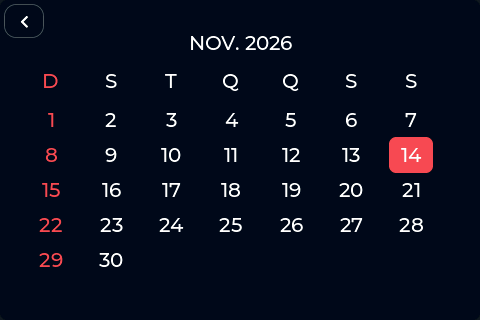
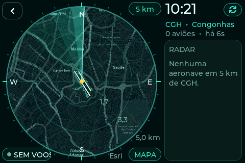
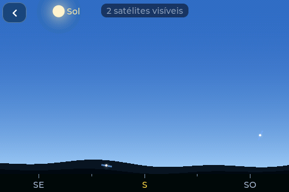
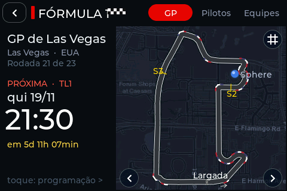
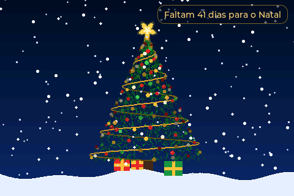
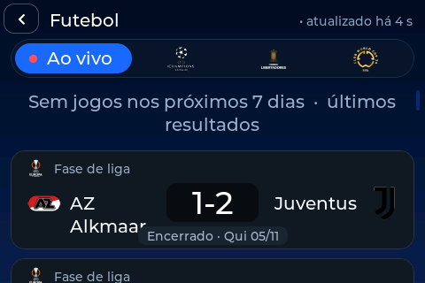

# NextNeo Vista

Firmware do sistema **NextNeo Vista** para a placa **Guition JC3248W535C** (ESP32-S3, tela 3,5" touch, usada na horizontal 480×320). O nome identifica o projeto e não aparece na interface do aparelho.

O app principal fica em `src/nextneo-vista/` (ambiente PlatformIO `nextneo-vista`). Ele tem menu inicial, **Clima**, **Finanças**, **Calendário**, **Radar aéreo** e **Ajustes**. Exemplos e jogos ficam em `examples/`.

> Especificação completa do produto: [`docs/index.html`](docs/index.html). É uma página única com hardware, mapa de pinos, catálogo de firmwares e arquitetura do hub.

---

## Sumário

0. [Comece aqui: guia para quem vem do Java](#0-comece-aqui-guia-para-quem-vem-do-java)
1. [Compilar e gravar (início rápido)](#1-compilar-e-gravar-início-rápido)
2. [Comandos úteis](#2-comandos-úteis)
3. [Por que não usar `-t upload`](#3-por-que-não-usar--t-upload-nesta-placa)
4. [Solução de problemas](#4-solução-de-problemas)
5. [Telas do app](#5-telas-do-app)
6. [Memória: PSRAM x RAM interna (TLS)](#6-memória-psram-x-ram-interna-tls)
7. [Estrutura do código e arquitetura](#7-estrutura-do-código-e-arquitetura)
8. [Hardware](#8-hardware)
9. [Exemplos e hub de jogos](#9-exemplos-e-hub-de-jogos)
10. [Histórico desta placa](#10-histórico-desta-placa)
11. [Testes automáticos (na placa)](#11-testes-automáticos-na-placa)

---

## 0. Comece aqui: guia para quem vem do Java

Esta seção é para quem programa em Java (ou outra linguagem de servidor) e nunca mexeu com C++ nem com placas. Se você já conhece o mundo embarcado, pule para a seção 1.

### 0.1 O que é este projeto, em uma frase

É **um único programa** (o *firmware*) que roda sozinho na placa, sem sistema operacional como Linux ou Windows por baixo. Ligou a placa, o programa começa; ele desenha a tela, lê o toque, conecta no Wi-Fi e chama APIs na internet.

Pense num `.jar` executável que **é** o computador inteiro: não existe "instalar outro app" nem "abrir o terminal" na placa. Para mudar qualquer coisa, você edita o código no Mac, compila e grava o programa novo por cima.

### 0.2 Dicionário Java → este projeto

| Aqui | Equivalente no Java | Observação |
|---|---|---|
| **ESP32-S3** | a "máquina" onde roda | Processador da placa: 2 núcleos, Wi-Fi, ~512 KB de RAM interna + 8 MB de PSRAM. |
| **Firmware** | o `.jar` da aplicação | O arquivo final é `nextneo-vista.bin`. |
| **PlatformIO** (`pio`) | Maven/Gradle | Baixa dependências, compila e grava. |
| **`platformio.ini`** | `pom.xml` / `build.gradle` | Define bibliotecas (`lib_deps`), flags de compilação e os "ambientes" (`[env:nextneo-vista]` ≈ um *profile*). |
| **`lib_deps`** | `<dependencies>` | Ex.: `lvgl`, `ArduinoJson`. Baixadas na 1ª compilação. |
| **Compilar** (`pio run`) | `mvn package` | Gera `.pio/build/nextneo-vista/nextneo-vista.bin`. |
| **Gravar / flash** | *deploy* | Copia o `nextneo-vista.bin` para a memória da placa pelo cabo USB. |
| **Monitor serial** | console / `System.out` | Os `Log.printf(...)` do código aparecem aqui. Também dá para ver em `http://IP-DA-PLACA/log`. |
| **`.h` e `.cpp`** | `interface` e `class` | O `.h` declara o que existe; o `.cpp` implementa. `#include "x.h"` ≈ `import`. |
| **`setup()` e `loop()`** | `main()` + `while (true)` | O Arduino chama `setup()` uma vez ao ligar e depois `loop()` para sempre. |
| **LVGL** | Swing / JavaFX | Biblioteca de interface: botões, labels, abas. Funções `lv_...`. |
| **Task do FreeRTOS** | `Thread` | Rede roda numa task separada (núcleo 0) para não travar a tela. |
| **`xSemaphoreTake/Give(mtx)`** | bloco `synchronized` | Protege o estado compartilhado `sh` entre a task de rede e a de tela. |
| **`Preferences`** (NVS) | `java.util.prefs` / arquivo de config | Guarda Wi-Fi, cidade, ativos etc. e sobrevive a reinício. |
| **PSRAM x RAM interna** | heap grande x heap pequeno | Não há *garbage collector*. Memória é escassa; veja a seção 6. |
| **`String` (Arduino)** | `String` | Parecida, mas mutável e cara em memória. |
| **Unity** | JUnit | Biblioteca de testes. `TEST_ASSERT_EQUAL(...)` ≈ `assertEquals(...)`. |
| **`pio test`** | `mvn test` | Compila os testes, grava na placa e mostra o resultado. Veja a seção 11. |

Três diferenças que pegam quem vem do Java:

1. **Não há garbage collector.** O que é alocado com `new`/`malloc` precisa ser liberado. Por isso o código reaproveita objetos e evita criar `String` à toa.
2. **Memória é muito pouca.** Um handshake HTTPS sozinho consome ~50 KB de RAM interna. Um erro de memória aqui não lança exceção bonita: a chamada simplesmente falha (veja a seção 6).
3. **Só a thread da tela pode mexer na tela.** É como a regra do Swing (EDT): a task de rede só grava dados em `sh` e a tela redesenha depois.

### 0.3 Instalar as ferramentas (uma vez só)

1. Instale o **VS Code** e, dentro dele, a extensão **PlatformIO IDE** (menu Extensions, busque "PlatformIO"). Ela instala o `pio` e o Python que ele usa.
   - Alternativa só com terminal: instale o [PlatformIO Core](https://platformio.org/install/cli).
2. Conecte a placa ao Mac com um cabo USB-C **de dados** (alguns cabos só carregam).
3. Confira se o Mac enxerga a placa:

   ```sh
   ls /dev/cu.usbmodem*
   ```

   Se aparecer algo como `/dev/cu.usbmodem1201`, está tudo certo. Não precisa instalar driver.

### 0.4 O ciclo de trabalho do dia a dia

```text
editar código (.cpp/.h)  →  testar na placa  →  gravar o app  →  olhar o log
```

Na prática é um comando só, dentro da pasta do projeto (`guition-jc3248w535c`):

```sh
cd ~/Documents/ChatGPT/"placa esp32"/guition-jc3248w535c
./tools/deploy_nextneo_vista.sh
```

> **Regra do projeto: deploy é sempre com teste.** O script roda os testes automáticos na placa e só grava o app se todos passarem (seção 1). Evite `pio run -t upload` direto: ele grava sem testar.

### 0.5 Onde fica o código de verdade

O projeto que é compilado fica em **`guition-jc3248w535c/src/nextneo-vista/`**. Existe também uma pasta `src/` na raiz de `placa esp32` com uma **cópia antiga**; ela não entra no build. Edite sempre dentro de `guition-jc3248w535c/`.

### 0.6 Primeira configuração do aparelho

1. Ligue a placa e abra **Ajustes** (ícone de engrenagem).
2. Em **Wi-Fi**, toque em buscar, escolha a rede, digite a senha e conecte.
3. Anote o endereço IP que aparece em Ajustes (ex.: `192.168.66.183`).
4. No celular ou computador, na mesma rede, abra `http://192.168.66.183`. É a **página web de configuração** (seção 5).
5. Em **Clima e relógio**, configure o local (veja a seguir).

### 0.7 Configurar o local do clima

O campo **Cidade** aceita dois formatos, tanto na página web quanto em Ajustes na placa:

| Formato | Exemplo | O que acontece |
|---|---|---|
| Nome da cidade | `São Paulo, BR` | A placa procura a cidade e usa o ponto "central" que o serviço adota. O `, BR` limita a busca ao Brasil. |
| Nome + coordenadas | `Minha casa @ -xx.xxx,-xx.xxx` | Usa exatamente esse ponto. O texto antes do `@` é só o nome mostrado na tela. |

**Como pegar as coordenadas:** no Google Maps, clique com o botão direito no local e clique nos números que aparecem (ex.: `-xx.xxx, -xx.xxx`). Eles são copiados. Cole depois do `@`.

Dicas:

- Use coordenadas se quiser a temperatura do seu bairro. "São Paulo, BR" cai na Zona Norte (≈ -23.51, -46.61).
- Primeiro vem a latitude (negativa no hemisfério sul), depois a longitude (negativa no Brasil).
- O nome/local só é usado pelo Clima e pelo Relógio. O fuso horário vem junto com a resposta do clima. O Radar usa o aeroporto configurado à parte.
- A temperatura vem do **Open-Meteo**, que é um modelo de previsão, não um termômetro. Pode ficar 1–3 °C diferente do Google/Climatempo, que usam estações de medição.

---

## 1. Compilar e gravar (início rápido)

**Pré-requisitos:** macOS com [PlatformIO Core](https://platformio.org/install/cli) (`pio`) e a placa conectada por USB. A placa usa o USB nativo do ESP32-S3 e aparece como `/dev/cu.usbmodem*`; não precisa de driver.

Abra o Terminal na pasta do projeto:

```sh
cd ~/Documents/ChatGPT/"placa esp32"/guition-jc3248w535c
```

### Opção A: deploy com testes (padrão)

```sh
chmod +x tools/deploy_nextneo_vista.sh     # só na primeira vez
./tools/deploy_nextneo_vista.sh
```

O script faz três coisas, nesta ordem, e **para no primeiro erro**:

1. **Testa:** roda os testes automáticos na placa (`pio test`, seção 11). Se algum falhar, o app **não** é gravado e a placa fica com o firmware de teste. A saída completa vai para `logs/test.log`.
2. **Compila** o app `nextneo-vista` e confere se ele cabe na partição de 3264 KB.
3. **Grava somente o app** em `0x10000` e confere o `Hash of data verified`. Bootloader, partições e Wi-Fi salvo ficam intactos.

Leva uns 6 minutos (5 dos testes). Variações:

```sh
./tools/deploy_nextneo_vista.sh /dev/cu.usbmodem1201        # informar a porta manualmente
SUITES="test_screens" ./tools/deploy_nextneo_vista.sh       # testar só uma suíte (mais rápido)
CLEAN=1 ./tools/deploy_nextneo_vista.sh                     # limpar o build antes
MONITOR=1 ./tools/deploy_nextneo_vista.sh                   # abrir o monitor serial no final
SKIP_TESTS=1 ./tools/deploy_nextneo_vista.sh                # EMERGÊNCIA: gravar sem testar
```

### Opção B: passo a passo

```sh
# 1) Limpar. Obrigatório após mudar flags do platformio.ini (ex.: alocador do LVGL)
pio run -e nextneo-vista -t clean

# 2) Compilar
pio run -e nextneo-vista

# 3) Descobrir a porta da placa
ls /dev/cu.usbmodem*

# 4) Gravar SOMENTE o app no offset 0x10000 (troque a porta se for diferente)
~/.platformio/penv/bin/python ~/.platformio/packages/tool-esptoolpy/esptool.py \
  --chip esp32s3 --port /dev/cu.usbmodem1201 --baud 921600 \
  write_flash --flash_size 16MB 0x10000 .pio/build/nextneo-vista/nextneo-vista.bin

# 5) Ver o log
pio device monitor -b 115200
```

A gravação deu certo se aparecer `Hash of data verified`. Para sair do monitor, use **Ctrl+C**.

> Se `pio` não for encontrado, use `~/.platformio/penv/bin/pio` no lugar.
> A primeira compilação baixa a plataforma ESP32 e as bibliotecas, então pode levar alguns minutos.

---

## 2. Comandos úteis

| Objetivo | Comando |
|---|---|
| Compilar sem gravar | `pio run -e nextneo-vista` |
| Limpar build | `pio run -e nextneo-vista -t clean` |
| **Deploy (testes + gravar app)** | `./tools/deploy_nextneo_vista.sh [porta]` |
| Só rodar os testes na placa | `pio test -e nextneo-vista` |
| Monitor serial | `pio device monitor -b 115200` |
| Listar portas | `ls /dev/cu.usbmodem*` ou `pio device list` |
| Tamanho do app | `ls -l .pio/build/nextneo-vista/nextneo-vista.bin` (limite: 3 342 336 bytes) |
| Hash do app gravado | `shasum -a 256 .pio/build/nextneo-vista/nextneo-vista.bin` |
| Apagar cache de build | `rm -rf .pio/build` (é recriado no próximo build) |

---

## 3. Por que não usar `-t upload` nesta placa

> **Atualizado em 2026-11-11:** este aviso valia para a tabela de fábrica, que não existe mais nesta placa.

A tabela original de fábrica tinha app0/app1 de 2 MB e uma FAT. Ela foi substituída pela tabela padrão do PlatformIO, `default_8MB.csv`, quando o app foi gravado com `-t upload`. Lendo a placa:

```text
nvs,      data, nvs,      0x9000,   20K
otadata,  data, ota,      0xe000,   8K
app0,     app,  ota_0,    0x10000,  3264K
app1,     app,  ota_1,    0x340000, 3264K
spiffs,   data, spiffs,   0x670000, 1536K
coredump, data, coredump, 0x7f0000, 64K
```

Essa tabela agora está fixada no `platformio.ini` (`board_build.partitions = default_8MB.csv`). Por isso:

- `pio run -e nextneo-vista -t upload` é seguro para a tabela: regrava a mesma, e o NVS (Wi-Fi e ajustes) continua no mesmo lugar. Mas grava **sem testar**; prefira o deploy.
- O script `tools/deploy_nextneo_vista.sh` testa, grava só o app e confere se ele cabe nos 3264 KB.
- **Não troque** `board_build.partitions` sem saber o que faz: uma tabela diferente pode apagar o Wi-Fi e os ajustes salvos.

Para conferir a tabela gravada na placa (só leitura):

```sh
~/.platformio/penv/bin/python ~/.platformio/packages/tool-esptoolpy/esptool.py \
  --chip esp32s3 read_flash 0x8000 0xC00 /tmp/pt.bin && \
~/.platformio/penv/bin/python ~/.platformio/packages/framework-arduinoespressif32/tools/gen_esp32part.py /tmp/pt.bin
```

> Os **exemplos/jogos** (seção 9) usam outra tabela (`hub_partitions.csv`) e o fluxo `tools/flash_hub.sh`. Gravar um deles troca a tabela e apaga o NextNeo Vista.

---

## 4. Solução de problemas

| Sintoma | O que fazer |
|---|---|
| `placa não encontrada` | Troque o cabo (alguns só carregam, sem dados) e confira `ls /dev/cu.usbmodem*`. |
| Gravação não inicia ou fica em `Connecting...` | Segure **BOOT**, toque em **RESET**, solte **BOOT** e rode de novo. |
| `Resource busy` na porta | Feche o monitor serial (Ctrl+C) ou outro programa usando a porta. |
| Erro de compilação após atualizar o código | Rode `pio run -e nextneo-vista -t clean` e compile de novo. |
| `app não cabe na partição` | O app passou de 3264 KB. Nada foi gravado; reduza imagens/fontes (o maior arquivo é `modules/clock/sky_images.c`). |
| Tela preta após gravar | Aperte RESET. Se continuar, olhe o monitor serial (`gfx->begin FAILED` indica problema de display ou framebuffer). |
| `SSL - Memory allocation failed (-32512)` | Falta de RAM **interna** para o TLS (veja a seção 6). No monitor, confira `maior bloco` nas linhas `[net]` e `[mem]`. Abaixo de ~22 KB o handshake falha. |
| Finanças sem atualizar | Veja no log: `HTTP 429` (limite do Yahoo; o app respeita `Retry-After`), `HTTP 401`/`403` (API recusou) ou `erro de transporte` + `[mem]` (memória/TLS). |
| Radar sem mapa | O mapa é opcional (botão **MAPA**). Em caso de falha, o app tenta de novo após 60 s; o log mostra `Mapa: ...`. |

### O que observar no monitor serial

> **Privacidade:** o log (serial e página `/log`) não mostra coordenadas, nome da cidade digitada, nome da rede Wi-Fi nem o IP de quem acessa a página web. O log fica só na memória da placa (PSRAM) e é apagado a cada reinício, inclusive a cada deploy. Arquivos `*.log` e a pasta `logs/` do computador ficam fora do git (`.gitignore`).

```text
[net] flight-radar ok em 640ms (interno livre 98000, maior bloco 61440)
ADSB.lol: 38211 bytes, 41 aeronaves (17 na área) em 520ms + parse 90ms
Mapa: 52344 bytes em 1300ms (ok)
adsbdb: e48a1b/TAM3201 -> 200 (Airbus A320 214 CGH>SDU)
[net] finance ok em 820ms (interno livre 101000, maior bloco 57344)
```

O número que importa para o TLS é o **maior bloco** de RAM interna.

---

## 5. Telas do app

Imagens tiradas da própria placa (480×320). A tela **Fotos** fica de fora porque mostra fotos pessoais. Nas imagens, a cidade aparece como "Minha cidade" e o nome da rede Wi-Fi e o IP estão cobertos.

| | | |
|---|---|---|
| **Menu**<br> | **Clima**<br> | **Finanças**<br> |
| **Calendário**<br> | **Radar aéreo**<br> | **Ajustes**<br> |
| **Servidores**<br> | **Relógio**<br> | **Aeroporto**<br> |
| **Céu**<br> | **Fórmula 1**<br> | **Arte**<br> |
| **Futebol**<br> | | |

> **Atualizar as imagens:** com a placa no USB, rode `./tools/capture_screenshots.sh`. Ele grava um firmware de captura (`test/test_screenshots`), abre cada tela, espera os dados chegarem, salva os PNGs em `docs/screens/` e, no fim, faz o deploy normal do app (com testes). Antes de fazer commit das imagens, **olhe cada uma**: elas mostram dados reais da placa.

### Menu
Ícones para as telas do app (Clima, Relógio, Finanças, Calendário, Radar, Aeroporto, Servidores, Fotos) e Ajustes. O ícone de Wi-Fi fica verde quando conectado.

### Clima
Dados do Open-Meteo (sem chave), com abas **Agora / Horas / Dias**. Atualiza a cada 10 min enquanto a tela está aberta. Em erro, tenta de novo em 1 min. Respostas inválidas não apagam a última previsão válida.

- A temperatura grande, o card **Agora** da lista de horas e o Relógio usam o mesmo valor (`current.temperature_2m`). Os demais cards de horas são previsões de 3 em 3 horas.
- **Condição "Agora" conferida:** o `weather_code` atual do Open-Meteo vem do modelo e às vezes diz "garoa" com sol (segue a chance de chuva das próximas horas). Para garoa/chuva (51–67), a placa só mostra chuva se a cobertura de nuvens for ≥ 60 % **e** estiver chovendo ≥ 0,2 mm; senão mostra o céu pela cobertura (limpo / poucas nuvens / parcialmente nublado / nublado) e registra no log. Previsão por hora e por dia não é alterada.
- O local vem do campo **Cidade** (nome ou `Nome @ lat,lon`). Veja a seção 0.7.

### Finanças
Mostra até **8 ativos** configuráveis: moedas, cripto, ações e índices, todos pelo símbolo do Yahoo Finance. O padrão é USD/BRL, EUR/BRL e BTC/USD.

- **Editar a lista:** na página web (`http://IP-DO-APARELHO`), seção **Finance**. Para cada ativo, informe o símbolo e uma legenda opcional. Há botões rápidos (Apple, Petrobras, Ibovespa, Ethereum, Libra).
- **Exemplos de símbolo:**

  | Tipo | Símbolos |
  |---|---|
  | Moedas | `USDBRL=X`, `GBPBRL=X` |
  | Cripto | `BTC-USD`, `ETH-USD` |
  | Ações dos EUA | `AAPL`, `MSFT` |
  | B3 (sufixo `.SA`) | `PETR4.SA`, `VALE3.SA` |
  | Índices | `^BVSP`, `^GSPC` |

- Um símbolo inexistente aparece como "sem cotação" na página e no cartão.
- **Na tela:** um cartão por ativo (deslize para o lado). O último cartão mostra o endereço da página para adicionar mais. O título usa a moeda devolvida pela API (`$`, `R$`, `€`...).
- **Atualização:** uma única chamada *spark* traz todos os ativos, a cada 2 min enquanto a tela está aberta. O *chart* serve de fallback por ativo, e tocar num cartão atualiza só aquele ativo. Há uma sessão TLS keep-alive por visita, e o `Retry-After` (HTTP 429) é respeitado com backoff de até 16 min.
- **Onde fica salvo:** Preferences, chave `finAssets`, uma linha `SÍMBOLO|Legenda` por ativo. Código em `finance_assets.cpp`.

### Radar aéreo
Tráfego ao vivo do [ADSB.lol](https://api.adsb.lol) num escopo circular, com o painel de informações à direita.

- **Escopo:** mapa escuro opcional, anéis de distância, bússola e varredura animada. Os aviões aparecem como ícones de jato, monomotor ou helicóptero, girados pelo rumo e coloridos pela altitude: verde < 2 000 ft, ciano < 10 000, azul < 25 000, lilás acima disso, laranja no solo e vermelho em emergência.
- **Fontes:** ADSB.lol primeiro; se falhar (429, conexão recusada, tempo esgotado), a mesma consulta usa o adsb.fi (mesmo formato de dados). Uma fonte que falhou fica em pausa 12 s, dobrando até 2 min. Código: `updateFlightRadarData()` em `flight_radar.cpp` e `services/adsblol_provider.cpp`.
- **Movimento suave:** consulta a cada 12 s e, entre consultas, move cada avião pela velocidade e rumo (*dead reckoning*).
- **Painel:** relógio, aeroporto, quantidade de aviões, idade dos dados e lista dos 5 mais próximos.
- **Toque num avião ou numa linha da lista:** abre o detalhe com companhia, rota (ex.: `CGH > SDU`), cidades e modelo (via [adsbdb.com](https://www.adsbdb.com), gratuito, com cache), além de altitude, velocidade, rumo, razão de subida/descida, distância, squawk e matrícula. O avião selecionado ganha destaque e rastro.
- **Botões:**
  - `25 km`: alterna o raio entre 5, 10, 25 e 50 km.
  - `MAPA`: liga/desliga o mapa.
  - `AO VIVO` e `↻`: atualizam na hora.
  - `×`: fecha o detalhe. Tocar no fundo do radar também fecha.
- **Mapa:** imagem *World Street Map* do Esri (endpoint `export`, sem chave), com cores invertidas e tingidas para o tema do radar (crédito "Esri" na tela; uso pessoal). Baixado só quando muda o aeroporto ou o raio. Ajuste de cor em `buildTintLut()` em `services/radar_map_provider.cpp`.
- **Aeroporto no radar:** pistas, taxiways e pátios do aeroporto configurado são desenhados por cima do mapa, com o norte para cima e na mesma projeção dos aviões. O desenho é feito uma vez, dentro da imagem do mapa (sem custo por frame), quando muda o aeroporto ou o raio. Em 5 km aparecem os pátios, os terminais e as taxiways; em 10 km, os pátios e as taxiways; em 25 e 50 km, só as pistas. A geometria vem do mesmo lugar que na tela Aeroporto: embutida (CGH), cache na flash (`/apt_XXX.bin`) ou, se não houver, OpenStreetMap/Overpass, baixado uma vez e salvo. O botão `MAPA` esconde só as ruas; o aeroporto continua. Código: `maybeFetchMap()` em `flight_radar.cpp` e `airportDrawRadarOverlay()` em `flight_airport.cpp`.
- **Sua localização:** ponto vermelho pulsando, na posição configurada no campo Cidade (`Nome @ lat,lon`). Só aparece se estiver dentro do raio. O pulso usa o mesmo timer da varredura, então só uma área de ~24 px é redesenhada. Código: `placeHome()` e `sweepTimerCb()` em `flight_radar.cpp`.
- **Configuração:** aeroporto (IATA/ICAO, ex.: `CGH`, `GRU`, `SBGR`) e raio em **Ajustes**. A varredura pode ser desligada com `SWEEP_ENABLED` em `modules/flight_radar/flight_radar.cpp`.

### Relógio ("Céu vivo")
Relógio grande sobre um céu animado que muda com a hora do dia e o clima (chuva, raios, neblina, estrelas). Usa os mesmos dados do Clima, pedidos só enquanto esta tela está aberta. Tocar alterna para um modo preto minimalista.

### Servidores
Estado dos servidores de casa (CPU, memória, disco etc.) lido do Beszel. Atualiza a cada 10 s enquanto a tela está aberta. Login e sistemas são configurados na página web.

### Aeroporto
Mapa do aeroporto com os aviões no solo e em pouso/decolagem (até ~200 m de altura).

- **Dados:** adsb.fi é a fonte principal desta tela (o ADSB.lol respondia 429 quase sempre aqui), com no mínimo 3,5 s entre consultas; ADSB.lol é o reserva, usado só enquanto o adsb.fi estiver em pausa. Uma rede que responde 429 ou falha fica em pausa 10 s, dobrando até 60 s; cada resposta boa reduz a pausa pela metade. Uma só rede por atualização (nunca mistura). Só enquanto a tela está aberta; entre consultas os aviões em movimento seguem pela posição estimada.
- **Movimento "ao vivo":** aviões acima de 30 kt com rumo conhecido são mostrados na posição estimada para agora (último dado + velocidade × tempo, no máximo 15 s à frente), como no Radar. Quando chega um dado novo, o ícone corrige a rota em 0,8 s, sem pular. Aviões lentos ou parados mostram só posições reportadas.
- **Aviões no pátio (só CGH):** aviões parados na posição de estacionamento quase não aparecem no ADS-B. A tela lê o painel de voos do site da Aena Brasil (o JSON `departureFligth` embutido na página de partidas e na de chegadas `?type=CHEGADAS&airportA=SBSP`), que traz o voo, o estado, o **box** (posição de estacionamento = `ref` do `parking_position` no OpenStreetMap) e o portão. Mostra no box: partidas "embarque próximo / iniciado / última chamada / confirmado / atrasado" (de 20 min antes a 60 min depois do horário) e chegadas "aeronave no pátio" (pousadas há até 90 min, se não houve depois partida encerrada naquele box). Cada página é lida a cada 3 min (alternando), sempre depois das posições. O ícone fica acinzentado e some assim que o mesmo voo aparece no ADS-B. Tocar abre posição, portão, estado e a rota (adsbdb por indicativo) por 5 s.
- **Toque num avião:** abre os detalhes; o toque usa a posição em que o ícone está desenhado.
- **Detalhes:** rota, companhia e modelo (adsbdb) são buscados só para o avião tocado, uma vez por avião enquanto a tela está aberta. O painel aparece por 5 s e fecha sozinho; tocar de novo reabre na hora (dados guardados). Uma tarefa paralela foi testada, mas a RAM interna nunca teve espaço para uma 2ª conexão TLS.

### Fotos
Porta-retratos com até 8 fotos enviadas pela página web; cada uma fica 30 s. Não usa internet.

### Ajustes (no aparelho)
Wi-Fi (buscar, escolher rede, senha, conectar), cidade do clima (aceita `Nome @ lat,lon`; toque em Enter no teclado para aplicar), formato 12/24 h, brilho, aeroporto e raio do radar. Os campos do radar acompanham mudanças feitas pela pílula de km ou pela página web.

### Página web de configuração
Com o celular ou computador na mesma rede, abra `http://IP-DO-APARELHO`. O IP aparece em Ajustes e no último cartão do Finance. As seções da página:

| Seção | O que configura |
|---|---|
| **Tela (desempenho)** | Velocidade da tela (40/60/80 MHz). Se aparecerem listras, volte para 40. |
| **Clima e relógio** | Cidade (`São Paulo, BR` ou `Nome @ lat,lon`) e relógio 24 h |
| **Radar aéreo** | Aeroporto (com lista de sugestões) e raio de 5, 10, 25 ou 50 km |
| **Finance** | Lista de até 8 ativos (símbolo + legenda), com a cotação atual de cada um |
| **Fotos** | Até 8 fotos para a tela Fotos (recorte feito no navegador) |
| **Servidores (Beszel)** | Login somente leitura do Beszel e o link de cada sistema monitorado |

Credenciais de Wi-Fi só são digitadas no próprio aparelho.

### Regras gerais de rede
Só a tela ativa faz chamadas de API, em uma tarefa de rede dedicada (núcleo 0) que nunca mexe na interface. Ao trocar de tela, pedidos pendentes da tela anterior são descartados e conexões keep-alive são fechadas. O Wi-Fi é verificado a cada minuto, com reconexão automática.

---

## 6. Memória: PSRAM x RAM interna (TLS)

Neste firmware, o **mbedTLS só aloca na RAM interna** (`CONFIG_MBEDTLS_INTERNAL_MEM_ALLOC`). Cada handshake HTTPS precisa de ~40–50 KB, em blocos contíguos. Quando outros módulos ocupam ou fragmentam essa RAM, o erro é:

```text
[E][ssl_client.cpp:41] _handle_error(): [start_ssl_client():318]: (-32512) SSL - Memory allocation failed
```

Regras adotadas no código:

| O quê | Onde fica | Arquivo |
|---|---|---|
| Objetos e estilos do LVGL | PSRAM (`LV_USE_STDLIB_MALLOC=LV_STDLIB_CUSTOM`) | `core/lv_mem_psram.cpp`, `platformio.ini` |
| Documentos JSON (ArduinoJson) | PSRAM (`SpiRamJsonAllocator`) | `services/psram_alloc.h` |
| Corpo das respostas HTTP | PSRAM (`PsramBuffer` + `writeToStream`, sem `String`) | `services/https_fetch.cpp` |
| Dados do radar, cache de rotas, mapa | PSRAM | `modules/flight_radar/flight_radar.cpp` |
| Buffer de desenho do LVGL (40 linhas) | RAM interna (desempenho) | `core/display_touch.cpp` |

Além disso:

- **Uma sessão TLS por vez:** o radar e as Finanças mantêm keep-alive só enquanto a tela está aberta. Antes de falar com outro host (adsbdb, Esri), a sessão anterior é fechada.
- Antes de um handshake, `tlsMemoryAvailable()` confere o maior bloco livre. Se estiver abaixo de 22 KB, a chamada falha com uma mensagem clara (`Memória baixa p/ TLS`) em vez do erro do mbedTLS.
- O core Arduino coloca na RAM interna toda alocação de até 4 KB feita com `malloc`/`new`. Para buffers novos, use `psramMalloc()`.

---

## 7. Estrutura do código e arquitetura

### 7.1 Pastas

```text
guition-jc3248w535c/
├── platformio.ini                 # ambientes; flags do LVGL (inclui alocador PSRAM)
├── tools/                         # deploy_nextneo_vista.sh (testes + gravação), flash_hub.sh, pio_progname.py
├── test/                          # testes automáticos que rodam na placa (seção 11)
└── src/nextneo-vista/
    ├── main.cpp                   # só a inicialização (appSetup) e o laço (appLoop)
    ├── app_screens.h              # "contrato" do app: estado compartilhado, IDs de tela, ScreenLifecycle
    ├── core/                      # infraestrutura, igual para todas as telas
    │   ├── screen_manager.*       # troca de telas + timer de atualização da tela ativa
    │   ├── screen_registry.h      # lista das telas (cada módulo define a sua)
    │   ├── net_worker.*           # tarefa de rede (núcleo 0): executa os jobs das telas
    │   ├── display_touch.*        # tela AXS15231B, touch e integração com o LVGL
    │   ├── web_config.*           # página web de configuração e log
    │   ├── ui_kit.cpp             # makeLabel, makeCard, botão voltar, texto seguro
    │   ├── app_state.cpp          # sh, cfg, mtx, prefs, hora local
    │   └── lv_mem_psram.cpp       # alocador do LVGL em PSRAM
    ├── modules/                   # uma pasta por tela
    │   ├── menu/                  # menu inicial (ícones, páginas, snapshot)
    │   ├── weather/               # weather_screen (tela) + weather_fetch (rede) + weather_codes
    │   ├── finance/               # finance_screen + finance_fetch + finance_assets
    │   ├── f1/                    # f1_screen + f1_fetch + f1_internal.h
    │   ├── football/              # football_screen + football_fetch + football_internal.h
    │   ├── servers/               # servers_screen + servers_data + servers_internal.h
    │   ├── flight_radar/          # radar: tela + parser/filtro/projeção separados
    │   ├── flight_airport/  sky/  clock/  calendar/  photos/  settings/  generative_art/
    │   └── <tela>/<tela>.h        # o que a tela oferece para OUTROS módulos (quando existe)
    ├── services/                  # HTTPS, alocação em PSRAM, log, provedores de aviões e mapas
    └── assets/fonts/              # fontes Montserrat com acentos
```

### 7.2 Como as peças conversam (comparando com Java)

```text
 Núcleo 1 (thread da tela, como a EDT do Swing)          Núcleo 0 (tarefa de rede)
 ┌───────────────────────────────────────────┐          ┌──────────────────────────┐
 │ screen_manager                            │  NetJob  │ net_worker               │
 │  └─ tela ativa: onEnter / render / onExit │ ───────► │  └─ job.run() (HTTP)     │
 │      timer → postScreenJob(CMD_...)       │  (fila)  │      grava resultado em  │
 │  render() lê `sh` / dados do módulo  ◄────┼──────────┼──── `sh` (com mutex)     │
 └───────────────────────────────────────────┘          └──────────────────────────┘
```

- **`ScreenLifecycle`** (em `app_screens.h`) é como uma *interface* Java que toda tela implementa: `build`, `onEnter`, `onExit`, `render`, os intervalos de atualização, a lista de **jobs de rede** (`NetJobDef`: comando + função `run()`) e `netRelease` (fechar conexões quando a tela sai).
- Cada módulo **define a sua** no fim do `<tela>_screen.cpp` (ex.: `kWeatherScreen`). O `screen_manager` só tem a lista delas, na ordem do `enum ScreenID`. Não existe mais um `switch` gigante de comandos: a tarefa de rede procura o job na tela que o pediu.
- **Só a tela ativa** busca dados. Cada job leva a tela e a "visita" (epoch) que o pediu; se o usuário saiu, o resultado é descartado. É assim que o app economiza a pouca RAM.
- Os **widgets** (`lv_obj_t *`) são `static` dentro do `.cpp` da tela, como campos `private`. Outras telas não conseguem mexer neles.
- Telas grandes separam **rede** (`*_fetch.cpp`/`*_data.cpp`) de **tela** (`*_screen.cpp`). O que os dois lados compartilham fica num `*_internal.h` com `namespace` próprio (equivale a classes *package-private*).

### 7.3 Criar uma tela nova (passo a passo)

1. Acrescente o ID no `enum ScreenID` em `app_screens.h` (antes de `SCREEN_COUNT`). Se ela busca dados na internet, acrescente também um `CMD_...` no `enum Cmd`.
2. Crie `modules/nova/nova_screen.cpp`. Os widgets e as funções ficam `static`, e no fim do arquivo vai o registro:

   ```cpp
   static const NetJobDef kNovaJobs[] = {{CMD_NOVA, "nova", novaFetch, true}};
   const ScreenLifecycle kNovaScreen = {
     SCREEN_NOVA, "nova", &novaView, buildNovaScreen, novaOnEnter, novaOnExit, novaRender,
     nullptr, 60000, 10000, kNovaJobs, 1, nullptr,
   };
   ```
3. Declare `extern const ScreenLifecycle kNovaScreen;` em `core/screen_registry.h` e coloque `&kNovaScreen` na lista `kScreens` de `core/screen_manager.cpp`, **na mesma posição do enum**.
4. Ponha o ícone no menu (`modules/menu/menu.cpp`, função `buildMenuScreen`) chamando `switchScreen(SCREEN_NOVA)`.
5. Inclua a tela nos testes (seção 11.6) e rode `pio test`. O teste `test_registry_lists_every_screen_in_order` avisa se a ordem estiver errada.

**Stack:** PlatformIO Core 6.x, plataforma pioarduino (Arduino-ESP32 3.x), LVGL 9.x, GFX Library for Arduino, ArduinoJson 7, JPEGDEC. A configuração do LVGL vem por flags (`-DLV_CONF_SKIP`), sem `lv_conf.h`.

---

## 8. Hardware

| Item | Valor |
|---|---|
| MCU | ESP32-S3 (QFN56, rev v0.2), dual-core, Wi-Fi + BLE |
| Flash | 16 MB quad (QIO) |
| PSRAM | 8 MB embutida (OPI) |
| Cristal | 40 MHz |
| USB | USB-Serial/JTAG nativo (VID:PID 303A:1001), sem CH340/CP210x |
| Display | IPS 3,5", 320×480, controlador AXS15231B, QSPI |
| Touch | Capacitivo, I2C 0x3B (integrado ao AXS15231B) |

| Função | GPIO |
|---|---|
| LCD CS / SCK | 45 / 47 |
| LCD D0 / D1 / D2 / D3 | 21 / 48 / 40 / 39 |
| Backlight | 1 |
| Touch SDA / SCL / INT | 4 / 8 / 3 |
| microSD CS / MOSI / SCK / MISO (SPI3/HSPI) | 10 / 11 / 12 / 13 |
| Áudio I2S BCLK / LRC / DOUT (NS4168, **não verificado**) | 42 / 2 / 41 |

### Observações de display e touch
- Desenhar direto no painel embaralha a imagem. Use `Arduino_Canvas` + `flush()`.
- Mantenha o painel no modo retrato nativo e gire o canvas (`gfx->setRotation(1)`). Girar o painel deixa a tela preta.
- Inicie o barramento a 40 MHz: `gfx->begin(40000000)`.
- O LVGL renderiza em modo PARTIAL (buffer de 40 linhas). O `flush_cb` copia para o canvas e chama `gfx->flush()` no último pedaço do frame.
- Leitura do touch: escreva `B5 AB A5 5A 00 00 00 08` em 0x3B e leia 8 bytes. `b[1]` = toques, x = `(b[2]&0x0F)<<8 | b[3]`, y = `(b[4]&0x0F)<<8 | b[5]`.
- O touch "pisca" enquanto o dedo está apoiado. Em botões, exija ~6 leituras vazias para considerar que o dedo saiu.
- Teclado na tela: use 320 px de altura e fonte de 20 pt nas teclas.

---

## 9. Exemplos e hub de jogos

| Exemplo | O que é |
|---|---|
| `examples/media-player` | Porta-retratos + vídeo MJPEG do microSD (`/pic`, `/mjpeg`). |
| `examples/music-player` | MP3/WAV/FLAC/AAC do microSD (`/music`). **Saída de áudio não verificada.** |
| `examples/paint` | Pintura com dedo; salva BMP em `/paint`. |
| `examples/tictactoe`, `game2048`, `snake`, `connect4`, `tetris`, `minesweeper`, `memory` | Jogos com recordes salvos na flash. |
| `examples/lvgl-basic` | Demo mínima do LVGL 9. |
| `examples/hub` | Lançador com um bloco por jogo, cada jogo no seu slot OTA. |

Compilar um exemplo: `pio run -e <nome>`. Instalar o hub completo: `tools/flash_hub.sh`, que usa `hub_partitions.csv` (`ota_0` = lançador, `ota_1..ota_10` = jogos).

> O hub e os exemplos usam `-t upload` e **outra tabela de partições**. Isso sobrescreve o NextNeo Vista e a tabela de fábrica descrita na seção 3.

Vídeo para o media player: `ffmpeg -i in.mp4 -vf "scale=480:320" -q:v 6 -r 20 out.mjpeg`.

---

## 10. Histórico desta placa

- **Firmware de fábrica:** substituído no app0 com aprovação do usuário. A leitura completa de 16 MB falhou (erros de CRC). Só existe um dump **parcial** em `../backups/esp32s3-flash-0-1MiB-partial-2026-10-28.bin`, que **não serve como backup restaurável**. O app1 (`0x210000`) estava vazio. Partições, NVS, OTA e FAT foram preservados.
- **2026-10-28:** primeira versão do app de clima (~1,68 MB). Tela preta corrigida mantendo o painel em retrato e girando o canvas.
- **2026-11-01:** fontes Montserrat com acentos (sem compressão). A versão comprimida deixava a tela sem texto. Build de 1 742 064 bytes gravado em `0x10000` com `Hash of data verified`.
- **2026-11-09:**
  - Radar aéreo redesenhado: escopo circular, mapa, rota/companhia via adsbdb e movimento suave.
  - Correção do erro `SSL - Memory allocation failed`: LVGL, JSON e respostas HTTP movidos para a PSRAM.
  - Finanças com sessão TLS única por visita.
  - Novo script de gravação (hoje `tools/deploy_nextneo_vista.sh`).
  - Esta versão ainda precisa ser compilada e conferida na placa.

- **2026-11-11:**
  - Card **Agora** da lista de horas passou a mostrar a mesma temperatura do bloco principal (antes mostrava a previsão da hora cheia e podia ficar 1–2 °C diferente).
  - Campo **Cidade** aceita coordenadas no formato `Nome @ lat,lon`, com dica na página web e em Ajustes.
  - README ganhou a seção 0, para quem vem do Java.
  - Tela Aeroporto: detalhes só ao tocar, painel fecha sozinho após 5 s.
  - Clima: "garoa" do Open-Meteo conferida com nuvens e chuva medida antes de aparecer no "Agora".
  - Tela Aeroporto (CGH): aviões no pátio a partir do painel de voos da Aena.
  - Radar: adsb.fi como reserva quando o ADSB.lol falha.
  - Tela Aeroporto: adsb.fi como fonte principal (3,5 s) e ADSB.lol de reserva, com pausa progressiva após 429.
  - Tela Aeroporto: toque nos aviões corrigido, posição estimada "ao vivo" para aviões em movimento, ADSB.lol a cada ~5 s.
  - Radar aéreo mostra a localização do aparelho como um ponto vermelho pulsando.
  - Radar aéreo desenha o aeroporto (pistas, taxiways, pátios) sobre o mapa de ruas; o botão MAPA esconde só as ruas.
  - Descoberto que a placa já usa a tabela `default_8MB.csv` (app de 3264 KB), não mais a de fábrica. Tabela fixada no `platformio.ini`, limite do script corrigido e seção 3 reescrita.
  - Esta versão ainda precisa ser compilada e conferida na placa.

Um backup completo de verdade exige ler os `0x1000000` bytes sem erros de CRC.

---

## 11. Testes automáticos (na placa)

Os testes conferem, sozinhos, que o **menu** e as **13 telas** abrem e funcionam. Rode-os depois de mexer no código e antes de fazer commit. Assim você não precisa abrir tela por tela com o dedo.

### 11.1 Como funciona, comparando com o Java

No Java, o `mvn test` roda os testes **no seu computador**. Aqui não dá: as telas precisam da tela, do touch, do Wi-Fi e da memória da placa. Por isso os testes **rodam dentro da placa**:

```text
pio test  →  compila um firmware de teste  →  grava na placa  →  a placa roda os testes
          →  o resultado volta pelo cabo USB  →  aparece PASSED/FAILED no seu terminal
```

| Aqui | No Java | O que é |
|---|---|---|
| `pio test -e nextneo-vista` | `mvn test` | Roda todos os testes. |
| pasta `test/test_menu/` | uma classe `MenuTest` | Uma **suíte**: um grupo de testes sobre um assunto. |
| `static void test_boot_lands_on_menu()` | método com `@Test` | Um teste. O nome começa com `test_`. |
| `RUN_TEST(test_boot_lands_on_menu);` | (automático no JUnit) | Em C++ cada teste precisa ser listado no `setup()` da suíte. |
| `setUp()` / `tearDown()` | `@BeforeEach` / `@AfterEach` | Rodam antes/depois de **cada** teste. Aqui `setUp()` sempre volta ao menu. |
| `TEST_ASSERT_EQUAL(esperado, atual)` | `assertEquals(esperado, atual)` | Falha o teste se os valores forem diferentes. |
| `TEST_ASSERT_NOT_NULL(x)` | `assertNotNull(x)` | Falha se `x` for nulo. |
| `test/support/ui_harness.h` | classe utilitária de teste | Funções comuns a todas as suítes (tocar num botão, achar o botão voltar...). |

> Cada suíte é gravada e roda **separada**: a placa reinicia entre uma e outra. É como se cada classe de teste rodasse numa JVM nova, então uma suíte não atrapalha a outra.

### 11.2 As suítes

| Suíte (pasta) | O que verifica | Testes |
|---|---|---|
| `test/test_menu/` | Ao ligar, aparece o menu. Existe um ícone para cada uma das 13 telas. Tocar em cada ícone abre a tela certa, e só ela fica visível. | 16 |
| `test/test_screens/` | Para cada tela: tem botão voltar; fica aberta 1,5 s (tempo de pedir dados à internet) sem travar nem pular para outra tela; o botão voltar leva ao menu. | 39 |
| `test/test_lifecycle/` | O "gerenciador de telas" (`switchScreen`): todas as telas registradas na ordem certa, ignora telas inválidas, não faz nada se a tela já está aberta, troca direto de uma tela para outra, e **não vaza memória** depois de abrir todas as telas 5 vezes. | 5 |

As 13 telas testadas: Clima, Finanças, Calendário, Radar, Ajustes, Servidores, Relógio, Aeroporto, Fotos, Céu, F1, Arte e Futebol.

> A pasta `test/test_screenshots/` **não** é uma suíte de verificação: é a ferramenta que tira as imagens da documentação (seção 5). Ela é ignorada pelo `pio test -e nextneo-vista` e pelo deploy, e roda só pelo `./tools/capture_screenshots.sh` (ambiente `nextneo-vista-docs`).

### 11.3 Passo a passo para rodar

**Antes de começar:**

- Siga a seção 0.3 (PlatformIO instalado e placa ligada no USB).
- A placa precisa estar com o **Wi-Fi já configurado** (seção 0.6). Os testes usam a internet de verdade, como o app.
- Feche o monitor serial se ele estiver aberto (`Ctrl+C`). Só um programa por vez pode usar o cabo.

**1. Abra o Terminal na pasta do projeto:**

```sh
cd ~/Documents/ChatGPT/"placa esp32"/guition-jc3248w535c
```

**2. Descubra a porta da placa:**

```sh
ls /dev/cu.usbmodem*
```

Deve aparecer algo como `/dev/cu.usbmodem1201`. Use esse nome nos comandos abaixo.

**3. Rode todos os testes** (leva uns 5 minutos, porque grava 3 firmwares):

```sh
~/.platformio/penv/bin/pio test -e nextneo-vista --upload-port /dev/cu.usbmodem1201 --test-port /dev/cu.usbmodem1201
```

Enquanto roda, a tela da placa fica trocando de tela sozinha. É normal: são os testes "tocando" nos botões.

**4. Leia o resultado.** No final aparece um resumo assim:

```text
nextneo-vista  test_menu       PASSED    00:01:54
nextneo-vista  test_screens    PASSED    00:01:51
nextneo-vista  test_lifecycle  PASSED    00:01:20
================= 60 test cases: 60 succeeded =================
```

**5. Grave o app de volta.** Depois dos testes, a placa fica com o firmware **de teste** (a tela para no último teste). Para testar **e** gravar o app num passo só, use o deploy (seção 1), que é o caminho normal:

```sh
./tools/deploy_nextneo_vista.sh
```

### 11.4 Rodar só uma suíte

Útil quando você mexeu numa coisa só e quer uma resposta rápida (cerca de 2 minutos). O `-f` filtra pelo nome da pasta:

```sh
~/.platformio/penv/bin/pio test -e nextneo-vista -f test_screens --upload-port /dev/cu.usbmodem1201 --test-port /dev/cu.usbmodem1201
```

Troque `test_screens` por `test_menu` ou `test_lifecycle`.

### 11.5 Quando um teste falha

A linha de falha diz **o arquivo, a linha, o teste e o motivo**. Exemplo:

```text
test/test_screens/test_main.cpp:119:test_back_returns_to_menu_f1:FAIL: Expected 1 Was 12. active screen should be the menu
```

Como ler:

- `test_back_returns_to_menu_f1`: o teste "o voltar da tela F1 leva ao menu".
- `Expected 1 Was 12`: esperava a tela de número 1 e encontrou a 12. Os números são a ordem do `enum ScreenID` em `src/nextneo-vista/app_screens.h`: 1 = menu, 2 = Clima, ..., 12 = F1, 13 = Arte, 14 = Futebol. Ou seja: tocou em voltar e continuou na F1.

Problemas comuns:

| Sintoma | Causa provável | O que fazer |
|---|---|---|
| `Could not open port` / `Resource busy` | Monitor serial ou outro programa usando o cabo. | Feche o monitor (`Ctrl+C`) e rode de novo. |
| Fica parado esperando resultado | Placa travou ou reiniciou durante o teste. | Aperte o botão **RST** da placa ou desconecte e reconecte o USB, e rode de novo. |
| `error:` com nome de arquivo `.cpp` | Erro de compilação (como no Java, o código não compila). | Leia a mensagem: ela aponta a linha. |
| Falha em `does_not_leak` | Uma tela está alocando memória e não libera ao sair. | Veja a mensagem `heap lost ...` e a seção 6. |

### 11.6 Criar uma tela nova? Crie o teste junto

Se você adicionar uma tela ao `enum ScreenID`, **os testes deixam de compilar** de propósito (há uma checagem `static_assert` em `test/support/ui_harness.h`). Para corrigir:

1. Em `test/support/ui_harness.h`, adicione uma linha na lista `kScreens` com o ID da tela e o texto do ícone no menu. Exemplo: `{SCREEN_NOVA, "Nova"},`. A view é encontrada sozinha (`screenView`).
2. No mesmo arquivo, adicione a tela nas duas macros `UI_TEST_PER_SCREEN` e `UI_RUN_PER_SCREEN`, copiando uma linha existente.
3. Rode os testes. A tela nova ganha automaticamente os testes de menu, de voltar e de memória.

> Detalhes técnicos:
> - Para os testes conseguirem ligar o app de verdade, o `main.cpp` tem `appSetup()`/`appLoop()`. No firmware normal, `setup()` só chama `appSetup()`. Nos testes, quem chama é a suíte (via `ui::bootApp()`).
> - Depois do boot, os testes desligam a cópia do log do app na serial (`gLogSerialEcho = false`) e voltam a esperar a USB (`Serial.setTxTimeoutMs(500)`). Sem isso, as linhas do log e as do Unity se misturavam, e o PlatformIO contava resultados a menos. O log continua sendo gravado na página `/log`.

